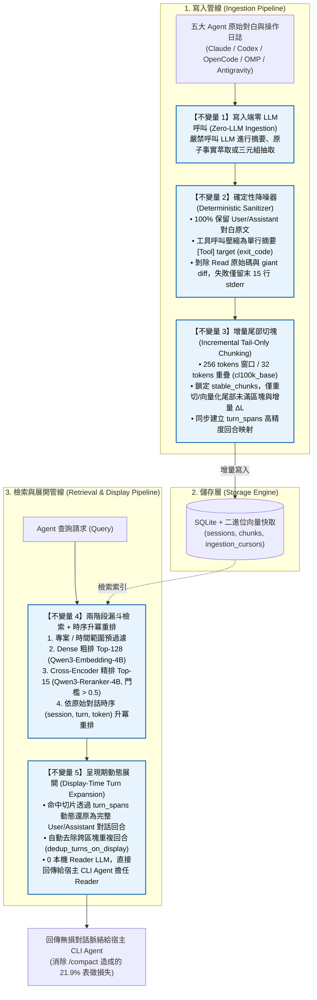

# `agent-raw-rag-mcp`

> 跨 CLI Coding Agent（**Claude Code**、**Codex CLI**、**OpenCode**、**Oh My Pi** 及 **Antigravity**）共用的本機 **Raw-RAG 增量記憶檢索與索引服務**。

---

## 1. 專案核心理念與解決痛點

傳統 Coding Agent 在處理長對話時，面臨兩大核心痛點：
1. **消除 `/compact` 滾動壓縮失憶**：CLI Agent 內建的 `/compact`（滾動式 LLM 摘要）實證會造成 **21.9% 永久表徵損失（Representation Loss）**。本服務在旁路以 Append-Only 保存 100% 原始對白切片，壓縮後隨時可按需無損救援。
2. **跨 Coding Agent 記憶互通**：同一個專案在 Claude Code、Codex、OpenCode、Oh My Pi 與 Antigravity 之間的架構決策、除錯脈絡與測試反覆紀錄集中索引，切換工具不斷線。
3. **寫入端零 LLM 呼叫，讀取端免跑本機 Reader LLM**：
   - **寫入端**：僅執行確定性降噪（Deterministic Sanitizer）與 $O(\Delta L)$ 尾部增量切塊，**完全不呼叫任何 LLM**。
   - **檢索端**：利用 Apple Silicon MLX 執行 `Qwen3-Embedding-4B`（粗排 Top-128）+ `Qwen3-Reranker`（精排 Top-15），展開後的完整對話回合直接交給當前宿主 Agent（Claude / GPT / Gemini）自行理解，不額外消耗本機生成模型的記憶體與 KV Cache。

---

## 2. 五大架構不變量（Architectural Invariants）

本專案嚴格遵從論文 **`Raw-RAG`**（*Is Complex Agentic Memory Always Needed? Naive RAG Is Stronger Than We Thought*, arXiv:2610.30755）經消融實驗證實最重要的五項原則：



---

## 3. 五大 Agent 原生 Discovery 與日誌支援

經實測與逆向分析各 Agent 核心機制，本服務提供全自動支援：

| Coding Agent | 日誌來源路徑 | 增量游標機制 | 原生 MCP 設定檔位置與規範 |
| :--- | :--- | :--- | :--- |
| **Claude Code** | `~/.claude/projects/<slug>/*.jsonl` | `(file_path, byte_offset)` | `~/.claude/.mcp.json` 或 `settings.json`（`mcpServers`） |
| **Codex CLI** | `~/.codex/sessions/**/rollout-*.jsonl` | `(file_path, byte_offset)` | `~/.codex/config.toml` 之 `[mcp_servers.raw_rag]` |
| **OpenCode** | `~/.local/share/opencode/opencode.db` | `(opencode_db, time_updated)` 唯讀游標串流 | `~/.config/opencode/opencode.jsonc`（`mcp` 節點） |
| **Oh My Pi (`omp`/`pi`)** | `~/.omp/agent/sessions/<slug>/*.jsonl` | `(file_path, byte_offset)` | **`~/.omp/agent/mcp.json`**（根物件須為 `mcpServers`，支援 `type: "stdio"`） |
| **Antigravity** | `~/.gemini/antigravity-cli/brain/*/.system_generated/logs/transcript.jsonl` | `(file_path, byte_offset)` | `~/.gemini/config/mcp_config.json` 與 `settings.json`（`mcpServers`） |

---

## 4. MCP Tools 與 CLI 規格

### 4.1 MCP Tools（標準 Stdio）

1. **`raw_rag_search`**
   - 參數：`query: str`, `project_path: Optional[str]`, `agent: Optional[str]`, `after_date: Optional[str]`, `before_date: Optional[str]`, `top_k: int = 15`
   - 功能：執行 Dense Top-128 粗排、MLX Reranker Top-15 精排、時序升冪重排，並展開完整對話回合。
2. **`raw_rag_recent`**
   - 參數：`project_path: Optional[str]`, `limit_turns: int = 30`
   - 功能：剛開啟 Session 或執行 `/compact` 後，取回該專案最近 $N$ 輪完整上下文。
3. **`raw_rag_ingest`**
   - 參數：`agent: Optional[str]`（可選 `'claude'`, `'codex'`, `'opencode'`, `'omp'`, `'antigravity'`）
   - 功能：手動或自動觸發增量日誌寫入與向量運算。
4. **`raw_rag_status`**
   - 功能：回傳目前的 Sessions 數、Chunks 總數與各 Agent 分佈。

### 4.2 CLI 命令與 `uvx` 隨選執行

本套件全面支援 Astral `uvx`（`uv tool run`），免手動啟用虛擬環境即可隨選執行：

```bash
# === 1. 隨選查看資料庫索引與推論引擎即時狀態 ===
# 本機開發模式：
uvx --from /Volumes/Samsung970EVOPlus/dev-projects/agent-raw-rag-mcp raw-rag-ingest --status
# PyPI 發布模式：
uvx --from agent-raw-rag-mcp raw-rag-ingest --status

# === 2. 隨選增量掃描同步 ===
uvx --from agent-raw-rag-mcp raw-rag-ingest --agent antigravity

# === 3. 隨選啟動 stdio MCP 伺服器 ===
uvx agent-raw-rag-mcp

# === 4. macOS LaunchAgent 系統常駐服務管理 ===
raw-rag-ingest --install-daemon    # 安裝並註冊 LaunchAgent 常駐背景服務
raw-rag-ingest --daemon-status     # 檢查 LaunchAgent 常駐服務運行狀態與日誌
raw-rag-ingest --uninstall-daemon  # 停止並卸載 LaunchAgent 服務
```

---

## 5. 快速安裝與開發

### 5.1 環境需求
- macOS（Apple Silicon M 系列晶片推薦）
- Python >= 3.11
- `uv` 套件管理器

### 5.2 安裝步驟

```bash
git clone https://github.com/yhsung/agent-raw-rag-mcp.git
cd agent-raw-rag-mcp

# 建立虛擬環境並安裝依賴
uv venv
source .venv/bin/activate
uv pip install -e . pytest
```

### 5.3 執行測試

```bash
# 執行全部單元與整合測試
uv run pytest -v
```

---

## 6. 深入文件
- **本機安裝與五大 Agent 設定實戰**：[`EXAMPLE.md`](./EXAMPLE.md)
- **PyPI 打包與發布標準作業程序**：[`docs/PUBLISHING.md`](./docs/PUBLISHING.md)
- **AI Agent 作業規範與架構邊界**：[`AGENTS.md`](./AGENTS.md)
- **詳細技術規劃與資料模型**：[`PLAN.md`](./PLAN.md)
- **論文復現與消融實驗報告**：[`reports/001-raw-rag-reproduction-report.md`](./reports/001-raw-rag-reproduction-report.md)

---

## 7. 引用與致謝（Citation & Acknowledgements）

本專案的底層記憶機制與架構依據 **RAW-RAG** 研究成果實作。若在研究或工程中使用本專案或原始論文，請引用原作者論文與官方專案：

- **官方專案**：[Litmeb/RAW-RAG (GitHub)](https://github.com/Litmeb/RAW-RAG)
- **論文**：*Is Complex Agentic Memory Always Needed? Naive RAG Is Stronger Than We Thought* (arXiv:2610.30755)

```bibtex
@misc{bao2026complexagenticmemory,
  title         = {Is Complex Agentic Memory Always Needed? Naive {RAG} Is Stronger Than We Thought},
  author        = {Bao, Zhengye and Zhang, Shengtao and Zhang, Haokai and Lou, Shiqi and Wen, Muning and Luo, Minnan},
  year          = {2026},
  note          = {arXiv preprint},
  eprint        = {2610.30755},
  archivePrefix = {arXiv},
  primaryClass  = {cs.AI},
  url           = {https://arxiv.org/abs/2610.30755}
}
```

---

## 8. 授權條款（License）

本專案採用 [MIT License](LICENSE) 開源授權條款。
