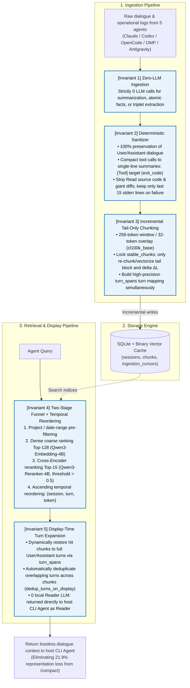

# `agent-raw-rag-mcp`

<p align="center">
  <b>English</b> | <a href="README.zh-TW.md">繁體中文</a>
</p>

> Cross-agent Raw-RAG incremental memory retrieval and indexing MCP service shared across **Claude Code**, **Codex CLI**, **OpenCode**, **Oh My Pi**, and **Antigravity**.

---

## 1. Core Philosophy & Pain Points Solved

Traditional coding agents face three critical challenges when handling long-horizon software engineering sessions:

1. **Eliminating Rolling Summarization Amnesia (`/compact`)**:
   Empirical research demonstrates that agent-native `/compact` commands (rolling LLM summarization) cause a **21.9% permanent representation loss**. `agent-raw-rag-mcp` maintains an append-only sidecar preserving 100% raw conversational slices, allowing lossless, on-demand context recovery after compaction.
2. **Cross-Coding-Agent Memory Interoperability**:
   Architectural decisions, debugging context, and test trial trails across Claude Code, Codex CLI, OpenCode, Oh My Pi, and Antigravity within the same project are indexed into a unified store—ensuring zero context loss when switching tools.
3. **Zero-LLM Ingestion & Zero Local Reader LLM**:
   - **Ingestion Pipeline**: Combines a Deterministic Sanitizer with $O(\Delta L)$ incremental tail-only chunking, making **exactly 0 LLM calls**.
   - **Retrieval Pipeline**: Executes on Apple Silicon MLX with `Qwen3-Embedding-4B` (Dense coarse ranking Top-128) + `Qwen3-Reranker-4B` (Cross-Encoder reranking Top-15). Retrieved slices are dynamically expanded into complete conversational turns and passed directly to the host agent (Claude / GPT / Gemini) as the reader, completely eliminating the KV cache and unified memory footprint of a local generation model.

---

## 2. Five Architectural Invariants

This project strictly adheres to the empirical principles established in the **`Raw-RAG`** paper (*Is Complex Agentic Memory Always Needed? Naive RAG Is Stronger Than We Thought*, arXiv:2610.30755):



---

## 3. Native Discovery & Agent Log Support

Based on empirical reverse engineering of each agent's execution model, `agent-raw-rag-mcp` provides out-of-the-box discovery and cursor management:

| Coding Agent | Log Source Path | Incremental Cursor Mechanism | Native MCP Configuration Spec |
| :--- | :--- | :--- | :--- |
| **Claude Code** | `~/.claude/projects/<slug>/*.jsonl` | `(file_path, byte_offset)` | `~/.claude/.mcp.json` or `settings.json` (`mcpServers`) |
| **Codex CLI** | `~/.codex/sessions/**/rollout-*.jsonl` | `(file_path, byte_offset)` | `~/.codex/config.toml` under `[mcp_servers.raw_rag]` |
| **OpenCode** | `~/.local/share/opencode/opencode.db` | Read-only cursor stream `(opencode_db, time_updated)` | `~/.config/opencode/opencode.jsonc` (`mcp` block) |
| **Oh My Pi (`omp`/`pi`)** | `~/.omp/agent/sessions/<slug>/*.jsonl` | `(file_path, byte_offset)` | **`~/.omp/agent/mcp.json`** (Root object must be `mcpServers`, supports `type: "stdio"`) |
| **Antigravity** | `~/.gemini/antigravity-cli/brain/*/.system_generated/logs/transcript.jsonl` | `(file_path, byte_offset)` | `~/.gemini/config/mcp_config.json` and `settings.json` (`mcpServers`) |

**OMP uses standard MCP only; no TypeScript extension is required.** With server name `raw-rag`, its tools are exposed as `mcp__raw_rag_search`, `mcp__raw_rag_recent`, `mcp__raw_rag_ingest`, and `mcp__raw_rag_status`. Remove the legacy `~/.omp/agent/extensions/raw-rag.ts` and restart OMP if previously installed; its native `raw_rag_*` tools use an incompatible execution contract. See [migration instructions](./EXAMPLE.md#b-工具入口與舊版遷移).

---

## 4. MCP Tools & CLI Specification

### 4.1 MCP Tools (Standard Stdio)

1. **`raw_rag_search`**
   - **Parameters**: `query: str`, `project_path: Optional[str]`, `agent: Optional[str]`, `after_date: Optional[str]`, `before_date: Optional[str]`, `top_k: int = 15`
   - **Function**: Executes Dense Top-128 coarse retrieval, MLX Cross-Encoder Top-15 reranking, temporal ascending reordering, and turns dynamic expansion.
2. **`raw_rag_recent`**
   - **Parameters**: `project_path: Optional[str]`, `limit_turns: int = 30`
   - **Function**: Retrieves the most recent $N$ conversational turns for a project immediately after session startup or `/compact`.
3. **`raw_rag_ingest`**
   - **Parameters**: `agent: Optional[str]` (one of `'claude'`, `'codex'`, `'opencode'`, `'omp'`, `'antigravity'`)
   - **Function**: Manually or programmatically triggers incremental log ingestion and vector calculation.
4. **`raw_rag_status`**
   - **Function**: Returns statistics on indexed sessions, total chunks, and distribution across agent sources.

### 4.2 CLI Commands & On-Demand `uvx` Execution

This package fully supports Astral `uvx` (`uv tool run`) for zero-install, on-demand execution without manually activating a virtual environment:

```bash
# === 1. Inspect database index and retriever status ===
# Local development mode:
uvx --from /Volumes/Samsung970EVOPlus/dev-projects/agent-raw-rag-mcp raw-rag-ingest --status
# PyPI release mode:
uvx --from agent-raw-rag-mcp raw-rag-ingest --status

# === 2. Run incremental log scanning and indexing on-demand ===
uvx --from agent-raw-rag-mcp raw-rag-ingest --agent antigravity

# === 3. Launch stdio MCP server on-demand ===
uvx agent-raw-rag-mcp

# === 4. macOS LaunchAgent background daemon management ===
raw-rag-ingest --install-daemon    # Install and register LaunchAgent background service
raw-rag-ingest --daemon-status     # Check LaunchAgent service status and logs
raw-rag-ingest --uninstall-daemon  # Stop and unregister LaunchAgent service
```

---

## 5. Quickstart & Installation

### 5.1 Prerequisites
- macOS (Apple Silicon M-series chips recommended)
- Python >= 3.11
- `uv` package manager

### 5.2 Setup

```bash
git clone https://github.com/yhsung/agent-raw-rag-mcp.git
cd agent-raw-rag-mcp

# Create virtual environment and install dependencies
uv venv
source .venv/bin/activate
uv pip install -e . pytest
```

### 5.3 Running Tests

```bash
# Run all unit and integration tests
uv run pytest -v
```

---

## 6. In-Depth Documentation
- **Local Setup & Five-Agent Integration Guide**: [`EXAMPLE.md`](./EXAMPLE.md)
- **PyPI Packaging & Publishing SOP**: [`docs/PUBLISHING.md`](./docs/PUBLISHING.md)
- **AI Coding Agent Operational Guidelines**: [`AGENTS.md`](./AGENTS.md)
- **Technical Architecture & Data Specifications**: [`PLAN.md`](./PLAN.md)
- **Paper Reproduction & Ablation Report**: [`reports/001-raw-rag-reproduction-report.md`](./reports/001-raw-rag-reproduction-report.md)

---

## 7. Citation & Acknowledgements

The core memory mechanics and architecture are implemented based on the **RAW-RAG** research. If you use this project or the underlying methodologies in your work, please cite the original authors' paper and repository:

- **Official Repository**: [Litmeb/RAW-RAG (GitHub)](https://github.com/Litmeb/RAW-RAG)
- **Paper**: *Is Complex Agentic Memory Always Needed? Naive RAG Is Stronger Than We Thought* (arXiv:2610.30755)

```bibtex
@misc{bao2026complexagenticmemory,
  title         = {Is Complex Agentic Memory Always Needed? Naive {RAG} Is Stronger Than We Thought},
  author        = {Bao, Zhengye and Zhang, Shengtao and Zhang, Haokai and Lou, Shiqi and Wen, Muning and Luo, Minnan},
  year          = {2026},
  note          = {arXiv preprint},
  eprint        = {2610.30755},
  archivePrefix = {arXiv},
  primaryClass  = {cs.AI},
  url           = {https://arxiv.org/abs/2610.30755}
}
```

---

## 8. License

This project is licensed under the [MIT License](LICENSE).
