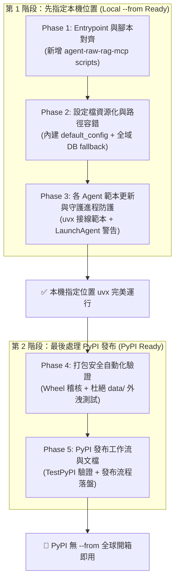

# 004: `agent-raw-rag-mcp` 支援 `uvx` 隨選執行與漸進式 PyPI 發布實作計畫

> **計畫編號**：`004`  
> **建立日期**：2026-10-26  
> **依據報告**：[`reports/006-uvx-execution-gap-analysis.md`](../reports/006-uvx-execution-gap-analysis.md)  
> **核心策略**：**先指定本機位置（Local `--from` Mode），最後才處理 PyPI**。分階段消除 Gap 1~6，使各 CLI Agent 能立刻以 `uvx --from <path> agent-raw-rag-mcp` 開箱運行，最後才進行 PyPI 生產發布。

---

## 1. 計畫目標與實施原則（Goal & Guiding Principles）

### 核心目標
徹底消除對本機固定虛擬環境路徑（`.venv/bin/raw-rag-mcp`）的脆弱綁定，使 `agent-raw-rag-mcp` 全面支援 Astral `uvx`（`uv tool run`）隨選即用。各 CLI Agent（Claude Code、Codex、OpenCode、Oh My Pi、Antigravity）僅需一行 `uvx` 配置即可調用記憶 MCP 伺服器與增量收集引擎。

### 漸進實施原則（Staged Rollout Principle）
1. **先本機路徑閉環（Local Path First）**：
   使用者與開發者在本地即可透過 `uvx --from /Volumes/Samsung970EVOPlus/dev-projects/agent-raw-rag-mcp agent-raw-rag-mcp` 或 `uvx --from . agent-raw-rag-mcp` 完美執行，不依賴外部網路與 PyPI。
2. **零路徑破壞（Zero Broken Paths）**：
   既有腳本（`raw-rag-mcp`、`raw-rag-ingest`）繼續保持向後相容，同時支援同名進入點 `agent-raw-rag-mcp`。
3. **最後處理 PyPI（PyPI as Final Step）**：
   待本機進入點、打包設定、全域儲存 fallback、MCP 配置範本與安全檢查全數綠燈後，最後一步才進行 PyPI Metadata 封裝與發布演練。

---

## 2. 階段劃分與工作分解結構（WBS）



---

### Phase 1：進入點命名與 CLI 腳本對齊（P0 Quick Win）

- **目標**：解決 `Gap 1`，讓 `uvx` 直接辨識 `agent-raw-rag-mcp` 作為可執行檔。
- **具體任務**：
  1. 修改 [`pyproject.toml`](file:///Volumes/Samsung970EVOPlus/dev-projects/agent-raw-rag-mcp/pyproject.toml)：
     在 `[project.scripts]` 中新增與套件同名的進入點：
     ```toml
     [project.scripts]
     agent-raw-rag-mcp = "agent_raw_rag.mcp_server:main"
     raw-rag-mcp = "agent_raw_rag.mcp_server:main"
     raw-rag-ingest = "agent_raw_rag.cli:main"
     ```
  2. 驗證本機呼叫：
     - `uvx --from . agent-raw-rag-mcp --help` 正常啟動 stdio MCP 伺服器或印出說明。
     - 既有 `raw-rag-mcp` 與 `raw-rag-ingest` 保持相容。
- **驗證指標**：執行 `uvx --from . agent-raw-rag-mcp` 不再出現 `An executable named agent-raw-rag-mcp is not provided`。

---

### Phase 2：設定檔內嵌資源化與全域儲存路徑容錯（P0 Portability）

- **目標**：解決 `Gap 3`，確保在脫離原專案目錄下以 `uvx --from <path>` 執行時，不因硬編碼目錄而崩潰。
- **具體任務**：
  1. **設定檔資源化**：
     - 將 `configs/default_config.yaml` 複製/連結至 `src/agent_raw_rag/resources/default_config.yaml`。
     - 在 `pyproject.toml` 的 hatchling wheel 配置中加入 package-data：
       ```toml
       [tool.hatch.build.targets.wheel]
       packages = ["src/agent_raw_rag"]
       [tool.hatch.build.targets.wheel.sources]
       "src/agent_raw_rag" = "agent_raw_rag"
       ```
     - 修改 `src/agent_raw_rag/config.py` 中的 `load_config`：
       若未指定且本機路徑不存在，使用 `importlib.resources.files("agent_raw_rag").joinpath("resources/default_config.yaml")` 讀取內建預設配置，最後退回 Dataclass 預設值。
  2. **SQLite 與全域儲存路徑容錯**：
     - 修改 `src/agent_raw_rag/config.py` 的 `StorageConfig`：
       ```python
       def default_sqlite_path() -> str:
           if "RAW_RAG_DB_PATH" in os.environ:
               return os.environ["RAW_RAG_DB_PATH"]
           local_dev_path = Path("/Volumes/Samsung970EVOPlus/dev-projects/agent-raw-rag-mcp/data/raw_rag.db")
           if local_dev_path.parent.exists():
               return str(local_dev_path)
           return str(Path.home() / ".agent-raw-rag" / "raw_rag.db")
       ```
     - 確保跨目錄或在其他機器執行時，自動於使用者目錄建立 `~/.agent-raw-rag/`，避免硬編碼路徑拋出 `FileNotFoundError`。
- **驗證指標**：切換至 `/tmp` 目錄，執行 `uvx --from /Volumes/Samsung970EVOPlus/dev-projects/agent-raw-rag-mcp raw-rag-ingest --status`，能順暢讀取狀態且不噴錯。

---

### Phase 3：各 Agent 接線範本更新與守護進程快取防護（P1 Integration）

- **目標**：解決 `Gap 4` 與 `Gap 5`，全面替換過時的 `.venv` 範本，並防範 LaunchAgent 殭屍化。
- **具體任務**：
  1. **更新各大 Agent 設定檔範本（指定本機位置版本）**：
     - 更新 `configs/claude_hooks_snippet.json`：
       ```json
       {
         "mcpServers": {
           "raw-rag": {
             "command": "uvx",
             "args": ["--from", "/Volumes/Samsung970EVOPlus/dev-projects/agent-raw-rag-mcp", "agent-raw-rag-mcp"],
             "env": { "HF_HOME": "/Volumes/Samsung980/hf-home/" }
           }
         }
       }
       ```
     - 更新 `configs/codex_config_snippet.toml` 與 `configs/opencode_snippet.json`。
     - 更新 `README.md` 的快速上手與 MCP 接線指引。
  2. **LaunchAgent 臨時環境快取偵測防護**：
     - 修改 `src/agent_raw_rag/cli.py` 的 `install_launch_agent()`：
       檢查 `sys.executable` 是否包含 `.cache/uv`；若是，印出警告訊息：
       `"⚠️ 偵測到正在 uvx 暫存環境中執行。uv cache prune 可能導致背景服務失效，常駐背景守護進程建議先執行 'uv tool install .'，或指定持久 Python 直譯器安裝。"`
- **驗證指標**：
  - 各 Agent 範本語法合規。
  - 新增單元測試 `tests/test_uvx_integration.py` 驗證 LaunchAgent 警告邏輯與範本格式。

---

### Phase 4：發布前打包安全性自動化稽核（P2 Security & Distribution）

- **目標**：建立發布防線，杜絕本機對白歷史、SQLite WAL 資料庫與私有 Token 意外流入發行套件。
- **具體任務**：
  1. 撰寫打包自動化測試 `tests/test_package_build.py`：
     - 呼叫 `uv build` 並解壓縮檢驗 `.whl` 與 `.tar.gz` 內容清單。
     - 斷言清單中**絕對不可**出現 `data/`、`*.db`、`*.wal`、`*.shm`、`transcript.jsonl` 等私有檔案。
     - 斷言 Wheel 必須包含 `agent_raw_rag` 模組與必要之 resources。
  2. 補齊 `pyproject.toml` 中的 PyPI 發布元資料：
     - `authors`、`license = { text = "MIT" }`、`urls`、`classifiers` 等。
- **驗證指標**：`pytest tests/test_package_build.py` 全綠通過。

---

### Phase 5：PyPI 發布工作流與無 `--from` 全球發行（Final Step）

- **目標**：落盤標準發布 SOP，支援 TestPyPI 驗證與 PyPI 正式發布。
- **具體任務**：
  1. 建立 GitHub Actions 自動發布工作流（`.github/workflows/publish.yml`）：
     - 觸發條件：推送 `v*` tag 時自動建置並發布至 PyPI（支援 Trusted Publisher 或 Token）。
  2. 撰寫發布操作手冊 `docs/PUBLISHING.md`（或於 `README.md` 增設專區）：
     - 詳細記載 TestPyPI 測試步驟與生產環境發布步驟。
  3. 驗證無 `--from` 之通用呼叫模式：
     `uvx agent-raw-rag-mcp` 與 `uvx --from agent-raw-rag-mcp raw-rag-ingest`。
- **驗證指標**：於 TestPyPI 成功上架並能透過 `uvx --index https://test.pypi.org/simple/ agent-raw-rag-mcp` 順利拉取執行。

---

## 3. 時程與驗證檢查表（Checklist）

| 階段 | 關鍵任務 | 優先級 | 交付檔案 / 產物 | 驗證標準 | 狀態 |
| :---: | :--- | :---: | :--- | :--- | :---: |
| **Phase 1** | 新增 `agent-raw-rag-mcp` 進入點 | **P0** | `pyproject.toml` | `uvx --from . agent-raw-rag-mcp` 成功執行 | ✅ **已完成** |
| **Phase 2** | 內嵌 default config & 全域 DB fallback | **P0** | `src/agent_raw_rag/config.py`<br>`src/agent_raw_rag/resources/` | 跨目錄（如 `/tmp`）調用不噴錯 | ✅ **已完成** |
| **Phase 3** | 更新各 Agent 範本 & 守護進程警告 | **P1** | `configs/*_snippet.*`<br>`src/agent_raw_rag/cli.py` | 範本可用，LaunchAgent 具備快取警示 | ✅ **已完成** |
| **Phase 4** | 打包安全性自動化測試 | **P2** | `tests/test_package_build.py` | 斷言 100% 排除 `data/` 與敏感資訊 | ✅ **已完成** |
| **Phase 5** | PyPI 發布手冊與工作流 | **P2** | `.github/workflows/publish.yml`<br>`docs/PUBLISHING.md` | TestPyPI / PyPI 演練與 SOP 落盤 | ✅ **已完成** |

---

## 4. 結論

本計畫明確落實使用者**「先指定位置，最後才處理 PyPI」**的策略：
- **前置階段（Phase 1~3）**：聚焦於本機可攜性與相容性，讓使用者在現有機台上透過指定位置（`--from`）立即享受零 `.venv` 維護負擔的 `uvx` 體驗。
- **收尾階段（Phase 4~5）**：在嚴格確保資料安全無外洩風險的前提下，才推進 PyPI 發布與開箱即用上架。
