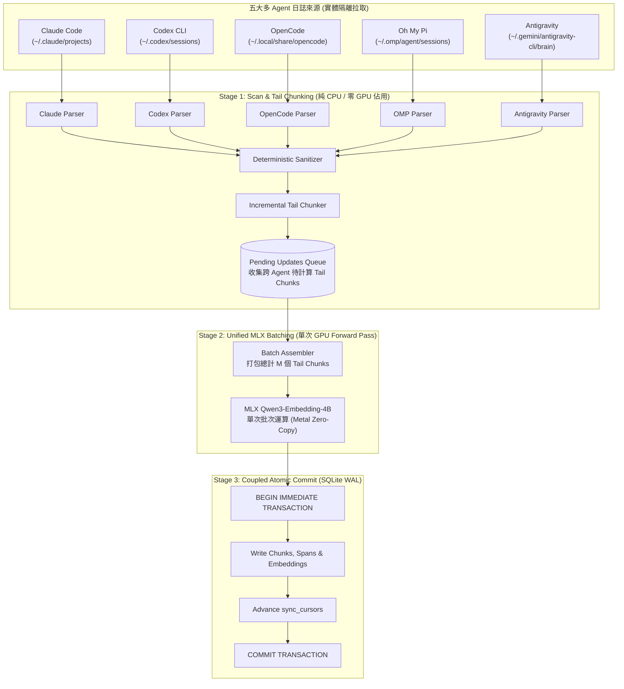

# Raw-RAG 背景常駐增量更新、多 Agent 併發處理與 Failsafe 架構下一輪修改規劃

> **專案**：`agent-raw-rag-mcp`  
> **基於報告**：[`reports/raw-rag-ingestion-concurrency-and-failsafe-architecture.md`](file:///Volumes/Samsung970EVOPlus/dev-projects/agent-raw-rag-mcp/reports/raw-rag-ingestion-concurrency-and-failsafe-architecture.md)  
> **目標讀者與執行者**：AI Coding Agent、系統架構師  
> **實作環境**：Apple Silicon (64GB Unified Memory), macOS, Python 3.12, MLX, SQLite WAL  
> **日期**：2026-10-26  

---

## 1. 執行背景與問題定義（Problem Statement & Motivation）

根據架構報告 [`reports/raw-rag-ingestion-concurrency-and-failsafe-architecture.md`](file:///Volumes/Samsung970EVOPlus/dev-projects/agent-raw-rag-mcp/reports/raw-rag-ingestion-concurrency-and-failsafe-architecture.md) 的實證分析，本專案在落實「長對話記憶跨 Agent 共享」與「消除 `/compact` 21.9% 永久表徵損失」的過程中，目前系統存在以下四個急需改善的架構瓶頸：

1. **多會話/跨 Agent 串列推論低效（Lack of Cross-Agent Batching）**：
   - 現行 [`cli.py`](file:///Volumes/Samsung970EVOPlus/dev-projects/agent-raw-rag-mcp/src/agent_raw_rag/cli.py) 的 `_process_turns_for_session` 是在每個 Session 掃描到增量後，立即呼叫一次 `retriever.embed_texts([c.content for c in tail_chunks])`。
   - 當開發者同時並行開啟多個 Agent（或單一 Agent 同時開啟多個工作區），每輪掃描會產生 $N$ 次獨立的 MLX Forward Pass 呼叫，造成 Metal 算力浪費與頻繁的 GPU 上下文切換。
2. **缺漏 Antigravity 原生支援（Missing Antigravity Parser）**：
   - 專案已支援 Claude Code、Codex CLI、OpenCode 與 Oh My Pi，但尚缺少 Google DeepMind 開發之 **Antigravity**（`~/.gemini/antigravity-cli/brain/<uuid>/.system_generated/logs/transcript.jsonl`）的專屬解析器，使 Antigravity 使用者無法將其深度對白自動納入跨工具共享記憶庫。
3. **儲存與游標非原子性耦合（Decoupled Commit-then-Advance）**：
   - 現行實作在 `_process_turns_for_session` 內寫入 Chunks，隨後在外部迴圈寫入 `save_cursor`，兩者分屬不同的 SQLite 交易。若進程在兩者之間遭遇 SIGKILL、OOM 或斷電，可能造成 Chunk 已落盤但游標未推進，或狀態不一致。
4. **系統級進程託管與自癒 CLI 工具鏈缺失（No Native LaunchAgent Lifecycle Management）**：
   - 報告定義了 macOS `launchd`（`com.raw-rag.ingest.plist`）的自動自癒與開機常駐規範，但使用者目前需手動撰寫與載入 XML 設定檔，缺乏 CLI 內建的 `daemon install/uninstall/start/stop/status/logs` 命令。
5. **壞檔與信號優雅退場不足（Poison-Pill & Graceful Shutdown）**：
   - 面對寫入中途的非法截斷 JSONL 或損毀檔案，需要健全的例外隔離防線，避免單一壞檔阻斷全域背景常駐掃描；同時需支援 `SIGINT`/`SIGTERM` 優雅退場，保證進行中的批次寫入完畢後安全退出。

---

## 2. 架構演進藍圖（Architectural Evolution）

下一輪修改將把單一會話即刻切塊推論模型，全面重構成 **「非阻塞多來源採樣 $\to$ 跨會話聚合批次推論 $\to$ 事務性原子落盤（Two-Stage Pipeline with Coupled Transaction）」**：



---

## 3. 核心設計規範與詳細規格（Detailed Technical Specifications）

### 3.1 規範一：Antigravity 日誌解析器（`antigravity_parser.py`）

#### 3.1.1 日誌結構分析
Antigravity 之 Session 存於 `~/.gemini/antigravity-cli/brain/<uuid>/.system_generated/logs/transcript.jsonl`：
- **使用者輸入（`type == "USER_INPUT"`）**：
  - `content` 包含 `<USER_REQUEST>\n...\n</USER_REQUEST>`，可能附帶 `<ADDITIONAL_METADATA>` 與 `<USER_SETTINGS_CHANGE>`。
  - **解析規格**：以正則式 `r"<USER_REQUEST>\s*(.*?)\s*</USER_REQUEST>"` 萃取真正的使用者 Prompt，若無標籤則保留過濾後主體，保持 100% 原始對話語意。
- **助理回應與思考（`type == "PLANNER_RESPONSE"`）**：
  - `thinking`：模型思維鏈，傳遞至 `sanitizer.sanitize_thinking`。
  - `tool_calls`：陣列結構 `[{"name": "...", "args": {...}}]`，格式化為單行 Action 摘要，例如 `[run_command] ls -la | [read_file] src/config.py`。
  - `content`：助理正式回覆文字，100% 原文保留。
- **工具回傳結果（`type == "GENERIC"`）**：
  - 承接上一輪 `tool_calls` 的指令輸出。由 `sanitizer` 判斷是否為 `run_command` 失敗輸出；若成功則捨棄 stdout 全文；若 `exit code != 0` 則提取末尾 15 行 stderr。
- **工作區與專案路徑**：
  - 檢視同目錄下之 metadata 或從 `transcript.jsonl` 第一行推斷 `workspace` 與 `conversation_id`。

#### 3.1.2 介面簽章
```python
class AntigravityParser:
    def __init__(self, sanitizer: DeterministicSanitizer): ...

    def parse_file_incremental(
        self,
        transcript_path: Path,
        start_offset: int = 0,
    ) -> Tuple[List[NormalizedTurn], int, SessionMetadata]:
        """增量解析 transcript.jsonl，回傳新 NormalizedTurn 列表、新 byte_offset 與 SessionMetadata。"""
```

---

### 3.2 規範二：跨 Agent 聚合批次推論（Cross-Session Batch Ingestion Engine）

#### 3.2.1 資料結構設計
在 `cli.py` / `engine/` 引入待處理階段物件：

```python
@dataclass
class PendingSessionUpdate:
    meta: SessionMetadata
    src_key: str
    agent: str
    new_offset: int
    new_timestamp: int
    updated_context: List[str]
    updated_units: List[TurnSpan]
    all_chunks: List[ChunkRecord]
    tail_chunks: List[ChunkRecord]
    first_changed_idx: int
```

#### 3.2.2 兩階段執行流程
1. **收集階段（Phase 1: Harvest & Chunk）**：
   - 遍歷所有已啟用的來源（Claude, Codex, OpenCode, OMP, Antigravity）。
   - 對每一個有增量的檔案呼叫其專屬增量解析器，產出 `new_turns`。
   - 呼叫 `chunker.add_incremental_turns`，產生 `tail_chunks`（尚未包含 embedding）。
   - 將 `PendingSessionUpdate` 物件推入清單 `pending_updates`。
2. **批次運算階段（Phase 2: Unified Batch Forward Pass）**：
   - 將 `pending_updates` 中所有 `tail_chunks` 扁平化展開為 `List[ChunkRecord]`。
   - 若總數 $> 0$：
     ```python
     all_tail_texts = [c.content for c in flat_tail_chunks]
     # 單次 MLX Forward Pass，充分發揮 Apple Silicon 記憶體頻寬
     batch_embeddings = self.retriever.embed_texts(all_tail_texts)
     for chunk, emb in zip(flat_tail_chunks, batch_embeddings):
         chunk.embedding = emb
     ```
3. **事務性原子落盤（Phase 3: Coupled Transaction Commit）**：
   - 呼叫 SQLiteStore 之批次原子寫入方法，將 Chunks 更新與 Cursors 推進包在同一個事務中。

---

### 3.3 規範三：儲存層事務原子性與 WAL 膨脹防護（SQLite Store Coupling & WAL Guard）

#### 3.3.1 事務耦合接口（`save_batch_session_chunks_and_cursors`）
在 [`store.py`](file:///Volumes/Samsung970EVOPlus/dev-projects/agent-raw-rag-mcp/src/agent_raw_rag/engine/store.py) 新增原子提交接口：

```python
def commit_batch_updates(
    self,
    updates: List[PendingSessionUpdate],
) -> None:
    """在單一 SQLite 交易內同時完成：
    1. 寫入多個 Session 的 chunks 與 turn_spans
    2. 更新所有 Session 對應的 sync_cursors
    任一環節失敗自動 ROLLBACK，保證游標永不超前於落盤資料。
    """
```

#### 3.3.2 WAL Checkpoint 主動維護
在長生命週期的背景 Daemon 模式下，頻繁寫入可能導致 `-wal` 檔案持續膨脹至數百 MB。
- **維護策略**：
  - 連線時設定：`PRAGMA journal_mode = WAL;`、`PRAGMA synchronous = NORMAL;`、`PRAGMA busy_timeout = 30000;`。
  - 在每一輪完成 Ingestion 且總新增 chunks 數累積達 100 個時，主動觸發：
    ```python
    conn.execute("PRAGMA wal_checkpoint(PASSIVE);")
    ```
  - 避免在有讀取者時進行 TRUNCATE 造成鎖阻塞。

---

### 3.4 規範四：Failsafe 壞檔隔離與優雅退場（Poison-Pill & Signal Handling）

1. **損毀檔案隔離（Poison-Pill Defense）**：
   - 單一日誌若出現 `json.JSONDecodeError` 或非預期 EOF（例如 Agent 正在高頻寫入未換行的片段）：
     - 捕獲異常並記錄 `logger.warning(f"Malformed tail in {path}:{offset}, skipping incomplete line")`。
     - 游標回退至最後一個合法換行符（`\n`）處的 offset，留待下一輪輪詢繼續讀取，絕不使 Daemon 進程崩潰。
2. **優雅信號退場（Graceful Shutdown）**：
   - 註冊 `signal.signal(signal.SIGINT, ...)` 與 `signal.signal(signal.SIGTERM, ...)`。
   - 收到信號時設置 `threading.Event` 或全域標誌 `self._running = False`。
   - 等待當前正在進行的 Batch Transaction 完成落盤後才退出迴圈。
   - 退出前調用 `self.retriever.release_conversation_search_cache()` 釋放 MLX Metal 暫態暫存記憶體。

---

### 3.5 規範五：macOS 原生常駐守護進程管理 CLI（`daemon` 子命令規格）

將 LaunchAgent 管理能力原生整合至 `agent-raw-rag` / `raw-rag-ingest` CLI：

```bash
agent-raw-rag daemon install    # 自動產生 ~/Library/LaunchAgents/com.raw-rag.ingest.plist 並註冊
agent-raw-rag daemon start      # launchctl bootstrap / load 啟動守護進程
agent-raw-rag daemon stop       # launchctl bootout / unload 停止守護進程
agent-raw-rag daemon status     # 查詢常駐 PID、記憶體與最新日誌
agent-raw-rag daemon restart    # 重新加載守護進程
agent-raw-rag daemon uninstall  # 停止並移除 plist 註冊檔
agent-raw-rag daemon logs [-f]  # 檢視背景常駐日誌（data/daemon.log）
```

#### 3.5.1 Plist 自動生成範本規範
- **標籤**：`com.raw-rag.ingest`
- **執行路徑**：自動探測當前環境之 `sys.executable`（例如 `.venv/bin/python`）與模組 `-m agent_raw_rag.cli --watch --interval 15`。
- **環境變數強制隔離**：
  ```xml
  <key>EnvironmentVariables</key>
  <dict>
      <key>HF_HOME</key>
      <string>/Volumes/Samsung980/hf-home/</string>
      <key>PATH</key>
      <string>/usr/local/bin:/usr/bin:/bin:/usr/sbin:/sbin</string>
  </dict>
  ```
- **日誌重導向**：重導向至專案下的 `data/daemon.log` 與 `data/daemon_err.log`（注意：嚴格遵守 `data/` 納入 `.gitignore`，不得被 git tracking）。

---

## 4. 模組變更清單與實施分期（Phased Implementation Plan）

```
agent-raw-rag-mcp/
├── src/agent_raw_rag/
│   ├── config.py                       # [MOD] 新增 antigravity source 與 daemon 配置
│   ├── models.py                       # [MOD] 新增 PendingSessionUpdate 結構
│   ├── parsers/
│   │   ├── __init__.py                 # [MOD] 匯出 AntigravityParser
│   │   └── antigravity_parser.py       # [NEW] Antigravity transcript.jsonl 增量解析器
│   ├── engine/
│   │   └── store.py                    # [MOD] 新增 commit_batch_updates 與 WAL 維護
│   ├── daemon.py                       # [NEW] macOS launchd plist 管理器與進程控制
│   └── cli.py                          # [MOD] 重構為兩階段批次收集、daemon 子命令與優雅退場
├── configs/
│   └── default_config.yaml             # [MOD] 新增 sources.antigravity 配置項
├── plans/
│   └── ingestion-concurrency-failsafe-plan.md # [NEW] 本技術規劃書
├── tests/
│   ├── test_antigravity_parser.py      # [NEW] Antigravity 解析器單元測試
│   ├── test_cross_agent_batching.py    # [NEW] 跨會話批次向量推論與事務測試
│   ├── test_failsafe_poison_pill.py    # [NEW] 壞行容錯與斷線自癒測試
│   └── test_daemon_lifecycle.py        # [NEW] Daemon plist 生成與語法驗證測試
└── AGENTS.md                           # [MOD] 更新五大 Agent 支援規格
```

---

### Phase 1：Antigravity 解析器與設定整合
- [x] **任務 1.1**：實作 [`src/agent_raw_rag/parsers/antigravity_parser.py`](file:///Volumes/Samsung970EVOPlus/dev-projects/agent-raw-rag-mcp/src/agent_raw_rag/parsers/antigravity_parser.py)
  - 正則提取 `<USER_REQUEST>` 正文。
  - 對 `PLANNER_RESPONSE` 提取 `thinking`、`tool_calls` 與助理正文。
  - 對 `GENERIC` 提取失敗 bash/run_command stderr。
  - 增量游標 `(transcript.jsonl, byte_offset)` 支援。
- [x] **任務 1.2**：修改 [`config.py`](file:///Volumes/Samsung970EVOPlus/dev-projects/agent-raw-rag-mcp/src/agent_raw_rag/config.py) 與 [`configs/default_config.yaml`](file:///Volumes/Samsung970EVOPlus/dev-projects/agent-raw-rag-mcp/configs/default_config.yaml)
  - 在 `SourcesConfig` 新增 `antigravity: SourceItemConfig(enabled=True, path="~/.gemini/antigravity-cli/brain")`。
- [x] **任務 1.3**：編寫 `tests/test_antigravity_parser.py`
  - 驗證真實 `transcript.jsonl` 片段解析正確性、降噪效果與 offset 推進。

---

### Phase 2：跨會話聚合批次推論與原子交易重構
- [x] **任務 2.1**：在 [`store.py`](file:///Volumes/Samsung970EVOPlus/dev-projects/agent-raw-rag-mcp/src/agent_raw_rag/engine/store.py) 實作 `commit_batch_updates(updates: List[PendingSessionUpdate])`
  - 使用 `with self.conn:` 封裝多 Session 的 Chunks 儲存與 Cursors 更新為單一交易。
  - 增加主動 WAL Checkpoint 機制（`PRAGMA wal_checkpoint(PASSIVE)`）。
- [x] **任務 2.2**：重構 [`cli.py`](file:///Volumes/Samsung970EVOPlus/dev-projects/agent-raw-rag-mcp/src/agent_raw_rag/cli.py) 之 `IngestionEngine`
  - 改寫 `ingest_claude`、`ingest_codex`、`ingest_opencode`、`ingest_omp` 與新增 `ingest_antigravity`，使其僅執行 Parse + Chunk 並回傳 `List[PendingSessionUpdate]`。
  - 統一在 `ingest_all` 匯總所有 `PendingSessionUpdate`。
  - 扁平化收集所有 `tail_chunks`，單次呼叫 `self.retriever.embed_texts` 完成 MLX Batch Embedding。
  - 呼叫 `store.commit_batch_updates` 一次性原子落盤。
- [x] **任務 2.3**：編寫 `tests/test_cross_agent_batching.py`
  - 模擬同時有 Claude, OMP, Antigravity 增量時，確認 `embed_texts` 只被呼叫 1 次且參數包含全部 tail chunks。

---

### Phase 3：Failsafe 壞檔隔離與斷線自癒機制
- [x] **任務 3.1**：在各解析器增量迴圈中實作 **Poison-Pill 隔離保護**
  - 行解析遭遇非預期壞格式時，記錄警告並跳過該行，將游標錨定在已確認之合法邊界。
  - 不拋出致命例外阻斷其他檔案的增量處理。
- [x] **任務 3.2**：編寫 `tests/test_failsafe_poison_pill.py`
  - 模擬寫入一半的未完成 JSON 字串，驗證下一輪完成寫入時能自動無損補讀。
  - 模擬資料庫寫入中途拋出例外，驗證游標未被推進（At-Least-Once 保證）。

---

### Phase 4：macOS LaunchAgent 常駐管理 CLI 與優雅退場
- [ ] **任務 4.1**：實作 [`src/agent_raw_rag/daemon.py`](file:///Volumes/Samsung970EVOPlus/dev-projects/agent-raw-rag-mcp/src/agent_raw_rag/daemon.py)
  - 封裝 `LaunchAgentManager`，處理 plist 模板生成、寫入 `~/Library/LaunchAgents/`、呼叫 `launchctl` 子進程命令。
  - 實作進程探測（透過 `launchctl list` 或 PID file 取得狀態）。
- [ ] **任務 4.2**：擴充 `cli.py` 支援 `daemon` 子命令
  - `agent-raw-rag daemon install|uninstall|start|stop|status|logs`
  - 支援 `--interval <seconds>` 輪詢頻率設定（預設 15 秒）。
  - 支援 `SIGINT` / `SIGTERM` 訊號攔截與資源釋放。
- [ ] **任務 4.3**：編寫 `tests/test_daemon_lifecycle.py`
  - 驗證 plist 語法正確性（符合 Apple DTD 規範）、環境變數是否正確綁定 `/Volumes/Samsung980/hf-home/`。

---

## 5. 驗收標準與效能指標（Acceptance Criteria & Metrics）

| 檢驗項目 | 驗收標準與可觀測指標 | 測試方法 |
| :--- | :--- | :--- |
| **Antigravity 解析正確性** | 完整保留 `<USER_REQUEST>` 原文；Tool 呼叫輸出被壓縮為單行摘要；成功由 `transcript.jsonl` 產生合規的 `NormalizedTurn` 與 `ChunkRecord`。 | `pytest tests/test_antigravity_parser.py` |
| **跨 Agent 聚合批次推論** | 當 3 個 Agent 同時各自產生 2 個尾部切片時，MLX `embed_texts` **只被呼叫 1 次**（Batch Size = 6），而非 3 次獨立呼叫。 | `pytest tests/test_cross_agent_batching.py` |
| **Commit-then-Advance 一致性** | 模擬在 `save_batch_session_chunks` 時觸發異常，驗證 `sync_cursors` 游標**完全未變**；修復後重跑，數據可冪等且完整落盤。 | `pytest tests/test_failsafe_recovery.py` |
| **Poison-Pill 壞行隔離** | 在日誌末端故意寫入半截 JSON（如 `{"step_index": 12, "cont...`），Daemon 正常記錄警告並跳過，不中斷整體輪詢。 | `pytest tests/test_failsafe_poison_pill.py` |
| **LaunchAgent CLI 語法合法性** | 產生的 `com.raw-rag.ingest.plist` 通過 macOS `plutil -lint` 驗證，路徑與 `HF_HOME` 設定完整。 | `plutil -lint ~/Library/LaunchAgents/com.raw-rag.ingest.plist` |
| **Data 目錄保護遵守** | `data/` 與 `data/daemon.log` 絕對不被加入 git 版控（`git status` 無 `data/` 追蹤）。 | `git status --ignored` 確認被忽略 |

---

## 6. 風險分析與因應對策（Risk Assessment & Mitigations）

1. **風險：多會話聚合批次過大造成 Metal 顯存短暫尖峰**
   - *因應*：在 `Batch Assembler` 設置 `max_batch_size = 64`。若跨會話尾部切片總數超過 64，自動分批為 `[0:64]`, `[64:128]` 循序送入 MLX，避免大批次占用過多統一記憶體。
2. **風險：Antigravity 的日誌檔案隨對話進行頻繁改寫**
   - *因應*：`transcript.jsonl` 為標準 Append-Only 日誌。我們使用 `byte_offset` 游標定位，僅在 `file_size > last_offset` 時讀取尾部；若檔案長度變小（例如工作區被重置），則重置游標為 0 重新索引。
3. **風險：macOS launchd 在主機休眠喚醒後頻繁拉起**
   - *因應*：在 plist 的 `KeepAlive` 中配置 `<key>SuccessfulExit</key><false/>` 與 `<key>Crashed</key><true/>`，使正常退出時不反覆重啟；若需循環監聽，則依賴內部的 `--watch` 迴圈控制休眠，不依賴 launchd 頻繁重啟。
