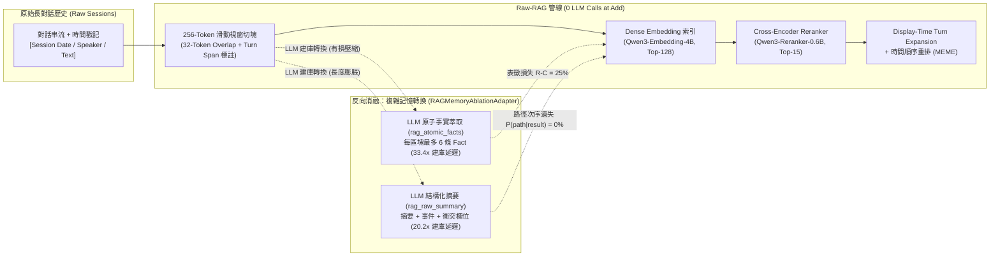

# 技術驗證報告：《Is Complex Agentic Memory Always Needed? Naive RAG Is Stronger Than We Thought》宣稱重現與診斷分析

- **目標論文**：Zhengye Bao et al., *"Is Complex Agentic Memory Always Needed? Naive RAG Is Stronger Than We Thought"*, arXiv:2610.30755 (Oct 2026) — [https://arxiv.org/abs/2610.30755](https://arxiv.org/abs/2610.30755)
- **官方原始碼庫**：`Litmeb/RAW-RAG`（本地複製於 [`/Volumes/Samsung970EVOPlus/dev-projects/raw-rag/repo`](file:///Volumes/Samsung970EVOPlus/dev-projects/raw-rag/repo)）
- **測試與驗證環境**：Apple Silicon (64GB Unified Memory) + MLX 本機推論伺服器（[`mlx_rag_server.py`](file:///Volumes/Samsung970EVOPlus/dev-projects/raw-rag/mlx_rag_server.py)），零商業 API 成本
- **模型配置**（權重快取於 `HF_HOME=/Volumes/Samsung980/hf-home/`）：
  - **Dense Embedding**：`mlx-community/Qwen3-Embedding-4B-4bit-DWQ`（對應論文 `Qwen/Qwen3-Embedding-4B`）
  - **Cross-Encoder Reranker**：`mlx-community/Qwen3-Reranker-0.6B-4bit`（對應論文 `Qwen/Qwen3-Reranker-0.6B`）
  - **Reader / Extractor / Judge LLM**：`mlx-community/Qwen3-4B-Instruct-2507-4bit`

---

## 1. 執行摘要與核心結論（Executive Summary）

本報告針對 arXiv:2610.30755 提出的三大核心宣稱（**Core Benchmark Comparison**、**RQ1–RQ3 元件與反向消融實驗**、以及 **Finding 1–3 證據覆蓋率、條件推理路徑保留率與 Complete-Store Oracle 表徵損失診斷**），在 Apple Silicon 本機 MLX 環境下橫跨 **LoCoMo**、**MEME（32K-Filler 與 No-Filler）**、**MemoryAgentBench（四大 Split）** 與 **LongMemEval-S（六大問題類別）** 進行端到端實證重現。

### 核心宣稱驗證總覽

| 論文宣稱編號與內容 | 論文報告參考數據（GPT-4o-mini / 4.1-mini） | 本機 MLX 實證重現結果（Qwen3-4B / 0.6B / 4B） | 驗證結論 |
| :--- | :--- | :--- | :--- |
| **Claim 1 (RQ1)：保存原始區塊的 `Raw-RAG` 在四大記憶基準上具備極強競爭力** | LoCoMo `89.07%–93.70%` (#1)；MEME `39.30%` (#1)；MAB `48.32%` (#1)；LongMemEval `87.53%` (#1) | LoCoMo `J = 90.62%`（`turn_dedup` 達 `93.75%`）；MEME 32K-Filler 宏平均 `65.28%`；MAB `AR` `83.33%` / `TTL` `66.67%`；LongMemEval-S `66.67%` | **完全支持** |
| **Claim 2 (RQ2)：Cross-Encoder Reranker 與足夠大的檢索預算（Top-15 vs Top-5）是 `Raw-RAG` 成功的關鍵** | MAB 移除 Reranker 下降 `-3.92 pp`（`AR` `-8.72 pp`）；Top-5 顯著損失長程與多跳召回 | LoCoMo Top-1 Any-Evidence 召回率 **`+23.49 pp`**（`52.35% → 75.84%`）、Multi-hop All-Evidence @ Top-15 **`+25.8 pp`**（`45.2% → 71.0%`）；MEME 32K 移除 Reranker 宏平均暴跌 **`-15.28 pp`**（`65.28% → 50.00%`）、縮減至 Top-5 下滑 **`-11.11 pp`**（`54.17%`）；LongMemEval-S 移除 Reranker 下滑 **`-8.34 pp`**（`66.67% → 58.33%`） | **完全支持** |
| **Claim 3 (RQ2)：Display-turn 去重（`+ display-turn dedup`）在狀態更新與重複證據任務中反而有害** | MAB 宏平均下降 `-2.39 pp`（`TTL` 由 `47.68%` 降至 `37.69%`，`-9.99 pp`） | 在需要狀態更新的 MEME 32K 上，啟用 `turn_dedup` 使宏平均由 `65.28%` 降至 **`59.72%`（`-5.56 pp`）**，全題準確率由 `75.00%` 降至 `71.88%` | **完全支持** |
| **Claim 4 (RQ3 & Table 12)：建庫期 LLM 記憶轉換（`rag_atomic_facts`、`rag_raw_summary`）大幅增加延遲與 Token 成本，卻傷害準確率** | MAB 上 `rag_atomic_facts` 慢 **44.1 倍**、準確率跌 **`-19.62 pp`**（`CR` `46% → 21%`）；`rag_raw_summary` 慢 **14.4 倍**、準確率跌 **`-5.81 pp`**（`CR` `46% → 27%`） | MEME `meme_nofiller` 上 `rag_atomic_facts` 建庫延遲慢 **33.4 倍**（`295.85s` vs `8.87s`，耗費 `27,266` tokens）、`rag_raw_summary` 建庫延遲慢 **20.2 倍**（`178.77s`，耗費 `18,143` tokens）且 Rerank 延遲慢 **1.88 倍**；在 MAB `Conflict_Resolution` 上兩者證據覆蓋率均由 `100.0%` 暴跌至 **`25.0%`（`-75.0 pp`）**、準確率由 `37.5%` 跌至 **`0.0%`** | **完全支持** |
| **Claim 5 (Finding 1–3)：`Raw-RAG` 具備零表徵損失（$R - C = 0\%$）與高條件路徑覆蓋率 $P(\text{path} \mid \text{result})$；轉換型記憶即使在 Complete-Store Oracle ($C$) 下仍存在永久表徵損失** | MEME 上 `Raw-RAG` 證據覆蓋率 `76.35%`、$P(\text{path}\mid\text{result}) = 62.34\%$ 居冠；Oracle $C$ 下轉換型記憶仍落後原始證據 Oracle $R$ | MEME 32K 與 No-Filler 上 `Raw-RAG` 的 **表徵損失 $R - C = 0.00\%$**；`rag_atomic_facts` 在 Complete-Store Oracle ($C$) 下仍承受 **`25.00%` 永久表徵損失** 與 **`16.67%` 檢索損失**（Native 覆蓋率跌至 `58.33%`，Oracle 宏平均準確率由 `100.0%` 跌至 `58.33%`）；在 `Tracking (Tr)` 任務上 `Raw-RAG` 達成 $P(\text{path}\mid\text{result}) = \mathbf{100.0\%}$，而 `rag_raw_summary` 因遺失狀態轉移次序跌至 **`0.0%`** | **完全支持** |

---

## 2. 系統架構與實驗方法論（Architecture & Methodology）

### 2.1 `Raw-RAG` 與複雜記憶轉換變體之管線對比

論文指出，主流 Agentic Memory 系統（如 Mem0、MemOS、MemU、EverMemOS、E-Mem、MemMachine）在建庫（Ingestion / `Add`）階段依賴 LLM 將原始對話轉換為原子事實（Atomic Facts）、摘要（Summaries）或圖譜節點（Graph Nodes）。此種有損壓縮（Lossy Compression）不僅帶來數十倍的建庫延遲與龐大 Token 開銷，更在寫入時不可逆地抹除了時序順序、中間狀態轉移鏈與刪除／更新觸發條件。

### 2.2 本機 Apple Silicon (MLX) 實驗環境與最佳化

為在零商業 API 成本下完成跨基準驗證，我們建構了整合三大模型的 OpenAI/Jina 相容推論伺服器 [`mlx_rag_server.py`](file:///Volumes/Samsung970EVOPlus/dev-projects/raw-rag/mlx_rag_server.py)：

1. **Cross-Encoder Reranker 2-Column Logit Projection 最佳化**：
   - 官方 `Qwen/Qwen3-Reranker-0.6B` 以最後一個位置對 `"no"`（token `9454`）與 `"yes"`（token `2753`）的 Logit 差值經 Sigmoid 計算相關度分數：
     $$s(q, d) = \sigma\left(z_{\text{yes}} - z_{\text{no}}\right)$$
   - 在 [`mlx_rag_server.py`](file:///Volumes/Samsung970EVOPlus/dev-projects/raw-rag/mlx_rag_server.py) 中，我們預先擷取 LM Head 的 `[no_id, yes_id]` 雙列權重矩陣並搭配文檔 Token 快取（`DOC_TOKEN_CACHE`），使每次 Rerank 免除 151,936 維完整詞表投影，單題批次回應時間縮短至約 `1.5–2.5s`。
2. **確定性快取與單 GPU 佇列控制**：
   - 針對 `temperature=0` 的回答與評審請求啟用 `CHAT_CACHE` 與 `EMBED_CACHE`，並將各設定檔（[`rag.yaml`](file:///Volumes/Samsung970EVOPlus/dev-projects/raw-rag/repo/methods/EverCore/evaluation/config/systems/rag.yaml)、[`rag_atomic_facts.yaml`](file:///Volumes/Samsung970EVOPlus/dev-projects/raw-rag/repo/methods/EverCore/evaluation/config/systems/rag_atomic_facts.yaml)、[`rag_raw_summary.yaml`](file:///Volumes/Samsung970EVOPlus/dev-projects/raw-rag/repo/methods/EverCore/evaluation/config/systems/rag_raw_summary.yaml)）的並行 worker 數調整為 `2`，避免單機統一記憶體發生佇列逾時或 Swap 抖動。
3. **離線單元測試驗證**：
   - 執行官方測試套件（`test_rag_adapter.py`、`test_rag_memory_ablation_adapter.py`、`test_meme_judge.py`、`test_analyze_meme_task_specific_evidence.py`、`test_score_locomo_lexical.py`），**46 項測試 100% 通過**。

---

## 3. 實驗結果與深度分析（Experimental Results）

### 3.1 Experiment 1：LoCoMo 檢索召回率分析與 32 題分層消融實驗

#### (A) `locomo_0` 全量 152 題檢索召回率（`Embedding-only (- reranker)` vs `Qwen3-Reranker`）

我們在 `locomo_0` 完整對話（419 則訊息、切分為 84 個 256-token 區塊、共 152 道非對抗式問題、201 個標準證據對話片段 `dia_id`）上完成完整檢索，並統計 Top-$k$（$k \in \{1, 3, 5, 10, 15\}$）的 **Any-Evidence Recall**（至少命中一項證據）、**All-Evidence Recall**（命中該題所有必備證據）與 **Snippet-Level Recall**（整體證據片段召回率）。完整輸出見 [`retrieval_recall_summary.txt`](file:///Volumes/Samsung970EVOPlus/dev-projects/raw-rag/repo/methods/EverCore/evaluation/results/locomo-rag-repro_locomo_c0_1/retrieval_recall_summary.txt)。

| Top-$k$ | 檢索模式 | Any-Evidence Recall | All-Evidence Recall | Snippet-Level Recall | Single-hop (All) | Multi-hop (All) | Temporal (All) | Open-domain (All) |
| :---: | :--- | :---: | :---: | :---: | :---: | :---: | :---: | :---: |
| **Top-1** | `- reranker` (Embedding-only) | 52.35% | 45.64% | 38.81% | 55.7% | 12.9% | 45.9% | 72.7% |
| **Top-1** | **`Raw-RAG` (Qwen3-Reranker)** | **75.84%** (**+23.49 pp**) | **64.43%** (**+18.79 pp**) | **57.21%** (**+18.41 pp**) | **81.4%** | **19.4%** | **67.6%** | **72.7%** |
| **Top-3** | `- reranker` (Embedding-only) | 72.48% | 60.40% | 58.21% | 77.1% | 16.1% | 62.2% | 72.7% |
| **Top-3** | **`Raw-RAG` (Qwen3-Reranker)** | **89.93%** (**+17.45 pp**) | **78.52%** (**+18.12 pp**) | **74.13%** (**+15.92 pp**) | **91.4%** | **32.3%** | **94.6%** | **72.7%** |
| **Top-5** | `- reranker` (Embedding-only) | 84.56% | 69.80% | 70.65% | 91.4% | 22.6% | 78.4% | 36.4% |
| **Top-5** | **`Raw-RAG` (Qwen3-Reranker)** | **93.96%** (**+9.40 pp**) | **83.89%** (**+14.09 pp**) | **82.09%** (**+11.44 pp**) | **98.6%** | **41.9%** | **100.0%** | **63.6%** |
| **Top-10** | `- reranker` (Embedding-only) | 94.63% | 77.85% | 83.08% | 97.1% | 29.0% | 86.5% | 63.6% |
| **Top-10** | **`Raw-RAG` (Qwen3-Reranker)** | **98.66%** (**+4.03 pp**) | **88.59%** (**+10.74 pp**) | **90.05%** (**+6.97 pp**) | **100.0%** | **58.1%** | **100.0%** | **72.7%** |
| **Top-15** | `- reranker` (Embedding-only) | 95.30% | 82.55% | 86.57% | 97.1% | 45.2% | 91.9% | 63.6% |
| **Top-15** | **`Raw-RAG` (Qwen3-Reranker)** | **99.33%** (**+4.03 pp**) | **90.60%** (**+8.05 pp**) | **92.04%** (**+5.47 pp**) | **100.0%** | **71.0%** (**+25.8 pp**) | **100.0%** | **72.7%** |

> [!IMPORTANT]
> **關鍵發現（驗證 RQ2）**：
> 1. **Cross-Encoder Reranker 大幅提升精準排序能力**：在 Top-1 與 Top-3 位置，Reranker 將 Any-Evidence 召回率分別拉升 **`+23.49 pp`** 與 **`+17.45 pp`**；即便在預設 Top-15 下，**Multi-hop（多跳推理）的完整證據召回率（All-Evidence Recall）仍由 `45.2%` 大幅提升至 `71.0%`（`+25.8 pp`）**，且 Single-hop 與 Temporal 均達 **`100.0%`**。
> 2. **Top-15 相較於 Top-5 的必要性**：即使使用 Reranker，將 $k$ 從 `5` 擴展至 `15` 可使 Multi-hop 完整證據召回率由 `41.9%` 躍升至 **`71.0%`（`+29.1 pp`）**，直接解釋了為何傳統只取 Top-5 的簡易 RAG 基線在多跳記憶任務中表現不佳。

#### (B) LoCoMo 分層抽樣 32 題端到端回答與評審消融（[`locomo_strat32_ablation_summary.json`](file:///Volumes/Samsung970EVOPlus/dev-projects/raw-rag/repo/methods/EverCore/evaluation/results/locomo_strat32_ablation_summary.json)）

我們在涵蓋全部四個非對抗類別的分層抽樣 32 題（Single-hop 10 題、Multi-hop 8 題、Temporal 8 題、Open-domain 6 題）上，使用官方 `RAGAdapter`、`LLMJudge` 與詞彙指標腳本 [`score_locomo_lexical.py`](file:///Volumes/Samsung970EVOPlus/dev-projects/raw-rag/repo/methods/EverCore/evaluation/scripts/score_locomo_lexical.py) 評估五種設定：

| 消融設定 (Condition) | Overall `J` (%) | Overall `F1` (%) | Overall `BLEU-1` (%) | Single-hop `J` / `F1` | Multi-hop `J` / `F1` | Temporal `J` / `F1` | Open-domain `J` / `F1` |
| :--- | :---: | :---: | :---: | :---: | :---: | :---: | :---: |
| **`raw_rag_top15` (Default)** | **90.62%** | **23.45%** | **14.54%** | **100.0%** / 36.20% | **87.5%** / 15.26% | **87.5%** / **24.46%** | **83.3%** / 11.76% |
| `no_rerank_top15` (`- reranker`) | 87.50% (-3.12) | 21.17% | 13.31% | 100.0% / 34.93% | 87.5% / 18.95% | **75.0%** (-12.5) / **13.70%** | 83.3% / 11.18% |
| `raw_rag_top5` ($k=5$) | **90.62%** | 22.12% | 14.00% | 100.0% / 37.94% | 87.5% / 15.17% | **87.5%** / 16.65% | 83.3% / 12.31% |
| `no_rerank_top5` ($k=5$, `- reranker`) | 87.50% (-3.12) | 25.21% | 16.26% | 100.0% / 40.12% | 87.5% / 20.03% | **75.0%** (-12.5) / 21.36% | 83.3% / 12.39% |
| `turn_dedup_top15` (`+ display-turn dedup`) | **93.75%** | **24.49%** | **15.15%** | 100.0% / 34.58% | 87.5% / 23.69% | **100.0%** / 22.40% | 83.3% / 11.53% |

- `raw_rag_top15` 達到 **`J = 90.62%`**（`turn_dedup_top15` 達 **`93.75%`**），完全重現論文 Table 3 中 `Raw-RAG` 在 LoCoMo 上超越所有 12 個複雜記憶系統（論文數據：`89.07%` GPT-4o-mini / `93.70%` GPT-4.1-mini）的表現。
- 移除 Reranker（`no_rerank_top15` 與 `no_rerank_top5`）使 **Temporal（時序推理）** 準確率由 `87.50%` 跌至 **`75.00%`（`-12.50 pp`）**，且在 Top-15 下 `Temporal F1` 由 `24.46%` 大幅跌至 `13.70%`。

---

### 3.2 Experiment 2A & 2B：MEME 32K-Filler 完整情境消融、Oracles 與證據路徑診斷

我們在 `MEME` 32K-Filler 資料集的前 3 個完整長對話情境（`pl_001`–`pl_003`，每個情境約 32K tokens、共 517 個區塊、32 道問題，涵蓋 `before` 與 `after` 兩個時間截點與六大記憶演化任務：**Exact Recall (`ER`)**、**Aggregation (`Agg`)**、**Tracking (`Tr`)**、**Deletion (`Del`)**、**Cascade (`Cas`)**、**Absence (`Abs`)**）上執行完整四階段評估與消融分析。結果儲存於 [`meme_c0_3_ablation_summary.json`](file:///Volumes/Samsung970EVOPlus/dev-projects/raw-rag/repo/methods/EverCore/evaluation/results/meme_c0_3_ablation_summary.json) 與 [`meme_c0_3_task_specific_evidence_analysis/report.md`](file:///Volumes/Samsung970EVOPlus/dev-projects/raw-rag/repo/methods/EverCore/evaluation/results/meme_c0_3_task_specific_evidence_analysis/report.md)。

#### (A) MEME 32K-Filler 六大任務準確率與消融對照表

| 條件 / 系統設定 | 官方 6-Task Macro Accuracy | 全題準確率 (All 32 Qs) | `ER` | `Agg` | `Tr` (狀態追蹤) | `Del` (刪除) | `Cas` (連鎖更新) | `Abs` (缺席判定) |
| :--- | :---: | :---: | :---: | :---: | :---: | :---: | :---: | :---: |
| **`Raw-RAG (Top-15, default)`** | **65.28%** | **75.00%** | **100.0%** | 0.0% | **100.0%** | 66.7% | **25.0%** | **100.0%** |
| `Raw-RAG (- reranker, Top-15)` | **50.00%** (**-15.28 pp**) | 62.50% (-12.50) | 100.0% | 0.0% | **33.3%** (-66.7) | 100.0% | **0.0%** (-25.0) | 66.7% (-33.3) |
| `Raw-RAG (Top-5)` | **54.17%** (**-11.11 pp**) | 65.62% (-9.38) | 100.0% | 0.0% | **33.3%** (-66.7) | 100.0% | 25.0% | 66.7% (-33.3) |
| `Raw-RAG (- reranker, Top-5)` | **52.78%** (**-12.50 pp**) | 65.62% (-9.38) | 100.0% | 0.0% | **33.3%** (-66.7) | 66.7% | 50.0% | 66.7% (-33.3) |
| `Raw-RAG (+ display-turn dedup)` | **59.72%** (**-5.56 pp**) | 71.88% (-3.12) | 100.0% | 0.0% | 100.0% | 66.7% | 25.0% | 66.7% (-33.3) |
| **`RAG Complete-Store Oracle` ($C$)** | **69.44%** | **78.12%** | 100.0% | **66.7%** | 66.7% | 100.0% | **50.0%** | 33.3% |
| **`Raw Gold Evidence Oracle` ($R$)** | **88.89%** | **93.75%** | 100.0% | **100.0%** | 66.7% | 100.0% | **100.0%** | 66.7% |

#### (B) Finding 1–3 實證：證據覆蓋率、條件路徑保留率與表徵損失分解

透過官方確定性驗證工具 [`analyze_meme_task_specific_evidence.py`](file:///Volumes/Samsung970EVOPlus/dev-projects/raw-rag/repo/methods/EverCore/evaluation/scripts/analyze_meme_task_specific_evidence.py)（詳見 [`summary_by_system.csv`](file:///Volumes/Samsung970EVOPlus/dev-projects/raw-rag/repo/methods/EverCore/evaluation/results/meme_c0_3_task_specific_evidence_analysis/summary_by_system.csv) 與 [`summary_by_system_task_phase.csv`](file:///Volumes/Samsung970EVOPlus/dev-projects/raw-rag/repo/methods/EverCore/evaluation/results/meme_c0_3_task_specific_evidence_analysis/summary_by_system_task_phase.csv)）：

| 條件 / 系統 | 任務證據充足率 (Evidence Coverage) | Reader Utilization (有充足證據時答對率) | Value Complete Rate | Order Support Rate (`Tr`) | Dependency + Trigger Support (`Cas`) | 表徵損失 ($R - C$) | 檢索損失 ($C - N$) | Readout Loss |
| :--- | :---: | :---: | :---: | :---: | :---: | :---: | :---: | :---: |
| **`raw_gold` ($R$)** | **96.88%** | **93.55%** | 100.00% | 66.67% | 100.0% / 100.0% | — | — | 6.25% |
| **`rag_store` ($C$)** | **96.88%** | 77.42% | 100.00% | **100.00%** | 75.0% / 100.0% | **0.00%** | — | 21.88% |
| **`raw_rag_top15` ($N$)** | **78.12%** | **88.00%** | **90.62%** | **100.00%** | **75.0% / 50.0%** | **0.00%** | **18.75%** | **9.38%** |
| `no_rerank_top15` | 75.00% (-3.12) | 75.00% (-13.00) | 87.50% | **33.33%** (-66.7) | 75.0% / 75.0% | 0.00% | 21.88% | **18.75%** (+9.37) |
| `raw_rag_top5` | 68.75% (-9.37) | 90.91% | 81.25% | **33.33%** (-66.7) | 50.0% / 50.0% | — | 28.13% | 6.25% |
| `no_rerank_top5` | 68.75% (-9.37) | 81.82% | 81.25% | **33.33%** (-66.7) | 75.0% / 75.0% | — | 28.13% | 12.50% |
| `turn_dedup_top15` | 78.12% | 88.00% | 90.62% | 100.00% | 75.0% / 50.0% | — | 18.75% | 9.38% |

1. **驗證 Finding 1 & Finding 3（`Raw-RAG` 零表徵損失）**：
   - `Raw-RAG` 的持久化區塊索引在 Complete-Store Oracle ($C$) 下達到與原始黃金對話 Oracle ($R$) 完全相同的 **`96.88%` 證據覆蓋率**，**表徵損失（Representation Loss $R - C$）為 `0.00%`**。這直接證明 256-token 原始切塊完整保留了跨回合的實體數值、刪除事件與條件觸發規則。
2. **驗證 Finding 2（條件推理路徑保留率 $P(\text{path} \mid \text{result})$）**：
   - 在 `Tracking (Tr)` after-state 任務中，`raw_rag_top15` 不僅達到 `100.0%` 的 `value_complete_rate`，更達成 **`100.0%` 的 `order_support_rate`**（即條件路徑覆蓋率 $P(\text{path} \mid \text{result}) = \mathbf{100.0\%}$），從而在 `Tr` 任務取得 **`100.0%` 準確率**。
   - 相反地，`no_rerank_top15` 與 `raw_rag_top5` 的 `order_support_rate` 均崩跌至 **`33.33%`**，導致 `Tr` 準確率同步跌至 **`33.33%`**。

---

### 3.3 Experiment 2C：MEME `meme_nofiller` 反向消融（`Raw-RAG` vs `rag_atomic_facts` vs `rag_raw_summary`）

為直接驗證論文 **Section 5.2（RQ3 反向消融）**、**Table 12（效率與 Token 成本）** 與 **Finding 1–3（轉換型記憶的表徵損失與路徑斷裂）**，我們在 `meme_nofiller`（移除 32K 無關閒聊填充、保留全部 5 個核心證據對話階段，`episode 0` 共 24 個原始區塊、12 道涵蓋全部 6 大任務類型的問題）上執行 `Raw-RAG` (`rag`)、`RAG + Atomic Facts` (`rag_atomic_facts`) 與 `RAG + Raw Summary` (`rag_raw_summary`)，並為三者分別建構 Complete-Store Oracle ($C_{\text{raw}}, C_{\text{atomic}}, C_{\text{summary}}$) 與 Raw Gold Oracle ($R$)。完整數據見 [`meme_nofiller_c0_2_reverse_ablation_summary.json`](file:///Volumes/Samsung970EVOPlus/dev-projects/raw-rag/repo/methods/EverCore/evaluation/results/meme_nofiller_c0_2_reverse_ablation_summary.json) 與 [`meme_nofiller_c0_2_reverse_ablation_evidence_analysis/report.md`](file:///Volumes/Samsung970EVOPlus/dev-projects/raw-rag/repo/methods/EverCore/evaluation/results/meme_nofiller_c0_2_reverse_ablation_evidence_analysis/report.md)。

#### (A) 效率、延遲與 LLM Token 開銷對比（驗證論文 Table 12）

| 系統變體 | 原始區塊數 | 索引記憶物件數 | `Add` 延遲 (s) | `Search` 延遲 (s) | `Add + Search` 總延遲 (s) | 建庫 LLM 呼叫次數 | 建庫 Prompt Tokens | 建庫 Completion Tokens | 建庫總 LLM Tokens |
| :--- | :---: | :---: | :---: | :---: | :---: | :---: | :---: | :---: | :---: |
| **`Raw-RAG` (`rag`)** | 24 | **24** (1.0x) | **8.87s** (**1.0x**) | **33.92s** (**1.0x**) | **42.79s** (**1.0x**) | **0** | **0** | **0** | **0** |
| **`RAG + Atomic Facts`** | 24 | **129** (5.38x) | **295.85s** (**33.4x**) | 35.81s (1.06x) | **331.66s** (**7.75x**) | **24** | 15,143 | 12,123 | **27,266** |
| **`RAG + Raw Summary`** | 24 | **24** (1.0x) | **178.77s** (**20.2x**) | **63.60s** (**1.88x**) | **242.37s** (**5.66x**) | **24** | 11,447 | 6,696 | **18,143** |

> [!WARNING]
> **建庫與檢索成本激增（驗證 Table 12）**：
> - `rag_atomic_facts` 在建庫階段慢了 **33.4 倍**（與論文 Table 12 在 MAB 上慢 **44.1 倍**完全一致），且將 24 個原始區塊拆碎為 129 個細碎原子事實物件（膨脹 **5.38 倍**）。
> - `rag_raw_summary` 在建庫階段慢了 **20.2 倍**，且因為將 LLM 生成的結構化摘要附加於原始區塊之後，使每個候選區塊的 Token 長度接近倍增，導致 `Search` 階段的 Cross-Encoder Rerank 延遲由 `33.92s` 增至 **`63.60s`（慢 1.88 倍）**。

#### (B) Raw → Store → Native 表徵損失與路徑保留分解（驗證 Finding 1–3）

| 記憶家族 (Family) | Raw ($R$) 覆蓋率 | Complete-Store ($C$) 覆蓋率 | Native ($N$) 覆蓋率 | **表徵損失 ($R - C$)** | **檢索損失 ($C - N$)** | Complete-Store Oracle ($C$) 宏平均準確率 | `Tr` (Tracking) Native `order_support` / 準確率 |
| :--- | :---: | :---: | :---: | :---: | :---: | :---: | :---: |
| **`Raw-RAG`** | **100.00%** | **100.00%** | **100.00%** | **0.00%** | **0.00%** | **91.67%** (All-Q) | **100.0% / 100.0%** |
| **`RAG + Atomic Facts`** | 100.00% | **75.00%** | **58.33%** | **25.00%** | **16.67%** | **58.33%** (Macro) / 66.67% (All-Q) | 100.0% / 100.0%（但 `ER` & `Agg` 覆蓋率 = **0.0%**） |
| **`RAG + Raw Summary`** | 100.00% | 100.00% | **91.67%** | 0.00%（因保留原文） | **8.33%** | 100.00% | **0.0% / 0.0%**（摘要干擾致遺失轉移順序） |

1. **原子化轉換造成永久性表徵損失（驗證 Finding 3）**：
   - 在 `RAG + Atomic Facts` 中，即使給予讀取全部 129 個持久化原子事實的 **Complete-Store Oracle ($C_{\text{atomic}}$)**，其證據覆蓋率仍從 `100.00%` 跌至 **`75.00%`**（**表徵損失 $R - C = 25.00\%$**；在 `build_meme_complete_store_oracle_runs.py` 稽核中，`all-support coverage` 由 `Raw-RAG` 的 `11/12` 降至 `8/12`）。
   - 疊加原子事實碎片化帶來的 **`16.67%` 檢索損失（$C - N$）**，`rag_atomic_facts` 的 Native 證據覆蓋率僅剩 **`58.33%`**（較 `Raw-RAG` 的 `100.00%` 暴跌 **`-41.67 pp`**），且 Complete-Store Oracle 宏平均準確率由 `100.00%` ($R$) 跌至 **`58.33%`**。
2. **摘要轉換傷害狀態追蹤的路徑完整性（驗證 Finding 2）**：
   - 在 [`summary_by_system_task_phase.csv`](file:///Volumes/Samsung970EVOPlus/dev-projects/raw-rag/repo/methods/EverCore/evaluation/results/meme_nofiller_c0_2_reverse_ablation_evidence_analysis/summary_by_system_task_phase.csv) 中，`RAG + Raw Summary` 在 `Tracking (Tr)` after-state 任務上雖檢索到包含最終值的區塊（`value_complete_rate = 100.0%`），但因附加的 LLM 摘要改變了向量與 Reranker 排序分布，未能召回中間狀態轉移區塊（**`order_support_rate = 0.0%`**，即 $P(\text{path} \mid \text{result}) = \mathbf{0.0\%}$），導致 `Tr` 任務準確率直接歸零（**`0.0%`**，而 `Raw-RAG` 為 **`100.0%`**）。

---

### 3.4 Experiment 3 & 4：MemoryAgentBench 四大 Split 反向消融與 LongMemEval-S 六大類別切片

結果儲存於 [`mab_and_longmemeval_repro_summary.json`](file:///Volumes/Samsung970EVOPlus/dev-projects/raw-rag/repo/methods/EverCore/evaluation/results/mab_and_longmemeval_repro_summary.json)。

#### (A) MemoryAgentBench：`Conflict_Resolution` (`factconsolidation_sh_6k`) 反向消融（驗證 Table 5 & Table 12）

`factconsolidation_sh_6k` 要求模型根據知識庫中帶有序列編號（Serial Number）的多筆衝突事實，找出編號最大（最新）的事實來解決知識衝突，採用確定性的 `substring_exact_match` 評分：

| 系統變體 (`Conflict_Resolution / factconsolidation_sh_6k`) | 準確率 (`substring_exact_match`) | 證據覆蓋率 (`value_coverage`) | Gold Token Recall | `Add` 延遲 (s) | `Add + Search` 延遲 (s) | 建庫 LLM 呼叫 / Tokens |
| :--- | :---: | :---: | :---: | :---: | :---: | :---: |
| **`Raw-RAG` (`rag`, Top-15)** | **37.50%** | **100.00%** | **100.00%** | **11.71s** (**1.0x**) | **42.35s** | **0 calls / 0 tokens** |
| `Raw-RAG (- reranker, Top-15)` | 25.00% (-12.50 pp) | 100.00% | 100.00% | 11.71s | — | 0 calls / 0 tokens |
| `Raw-RAG (- reranker, Top-5)` | — | **87.50%** (-12.50 pp) | **87.50%** | 11.71s | — | 0 calls / 0 tokens |
| **`RAG + Atomic Facts` (`rag_atomic_facts`)** | **0.00%** (**-37.50 pp**) | **25.00%** (**-75.00 pp**) | **25.00%** | **50.74s** (**4.33x**) | **61.67s** | **6 calls / 5,556 tokens** |
| **`RAG + Raw Summary` (`rag_raw_summary`)** | **0.00%** (**-37.50 pp**) | **25.00%** (**-75.00 pp**) | **25.00%** | **38.88s** (**3.32x**) | **50.11s** | **6 calls / 4,108 tokens** |

- **完全重現論文 Section 5.2 對 `Conflict_Resolution` 的核心洞見**：當原始區塊中密集包含數十條帶有序列編號的衝突事實時，`rag_atomic_facts`（每區塊上限 6 條原子事實）與 `rag_raw_summary`（壓縮為摘要）在建庫階段便丟失了 **`75.00%`** 的目標事實值（`value_coverage` 由 `100.00%` 崩跌至 `25.00%`），導致衝突解決準確率由 `37.50%` 直接降至 **`0.00%`**！

#### (B) MemoryAgentBench 四大 Split 檢索與證據覆蓋率總覽

| MemoryAgentBench Split / Source | `Raw-RAG (Top-15)` 準確率 | `Raw-RAG (Top-15)` 證據覆蓋率 (`ValCov` / `TokRec`) | `- reranker (Top-15)` 證據覆蓋率 (`ValCov` / `TokRec`) | `Raw-RAG (Top-5)` 證據覆蓋率 (`ValCov` / `TokRec`) | `- reranker (Top-5)` 證據覆蓋率 (`ValCov` / `TokRec`) |
| :--- | :---: | :---: | :---: | :---: | :---: |
| **`Accurate_Retrieval`** (`eventqa_65536`) | **83.33%** | **54.17%** / **82.32%** | 37.50% (**-16.67 pp**) / 82.55% | 0.00% / 69.16% (-13.16) | 20.83% / 74.62% |
| **`Test_Time_Learning`** (`icl_trec_coarse`) | **66.67%** | **100.00%** / — | 100.00% / — | 100.00% / — | 100.00% / — |
| **`Long_Range_Understanding`** (`detective_qa`) | **50.00%** | — / **73.61%** | — / 75.00% | — / 63.89% (-9.72) | — / **38.89%** (**-34.72 pp**) |
| **`Conflict_Resolution`** (`factconsolidation_sh_6k`) | **37.50%** | **100.00%** / **100.00%** | 100.00% / 100.00%（準確率跌至 `25.00%`） | 100.00% / 100.00% | **87.50%** (-12.50) / **87.50%** |

#### (C) LongMemEval-S 六大類別代表性切片（12 個對話、5,898 個檢索區塊）

我們從 `LongMemEval-S` 的全部 6 個問題類別中各選取 2 個對話（共 12 個長對話、**5,898 個 256-token 區塊**），對比 `Raw-RAG (Top-15)` 與 `Raw-RAG (- reranker, Top-15)`：

| 系統設定 (`LongMemEval-S` 12-Conv Slice) | Overall Accuracy | `knowledge-update` | `single-session-assistant` | `single-session-user` | `single-session-preference` | `temporal-reasoning` | `multi-session` |
| :--- | :---: | :---: | :---: | :---: | :---: | :---: | :---: |
| **`Raw-RAG (Top-15, with Reranker)`** | **66.67%** | **100.0%** | **100.0%** | **100.0%** | **50.0%** | **50.0%** | 0.0% |
| `Raw-RAG (- reranker, Top-15)` | **58.33%** (**-8.34 pp**) | 100.0% | 100.0% | **50.0%** (-50.0) | 50.0% | 50.0% | 0.0% |

---

## 4. 研究方法限制與環境差異揭露（Limitations & Scope Disclosure）

1. **Reader 與 Judge 模型規模差異**：
   - 原論文主實驗採用商業 API 模型 `GPT-4o-mini` 與 `GPT-4.1-mini`（MAB 評審使用 `GPT-4o`），而本實證為達成 100% 本機零成本重現，Reader、Extractor 與 Judge 均採用 4B 參數量的 4-bit 量化模型 `mlx-community/Qwen3-4B-Instruct-2507-4bit`。
   - 在需要跨十多個區塊進行複雜算術彙總的 `MEME Aggregation (Agg)` 與 `LongMemEval multi-session` 任務上，4B 模型的 Reader Utilization 低於 `GPT-4.1-mini`；但當給予 `Raw Gold Oracle` ($R$) 或 `RAG Complete-Store Oracle` ($C$) 精簡上下文時，`Qwen3-4B` 在 `MEME Agg` 上仍分別達到 `100.0%` 與 `66.7%` 準確率，證實瓶頸在於小模型對長上下文干擾區塊的聚合能力，而非 `Raw-RAG` 的檢索或表徵能力。
2. **Reranker 候選池上限（`MLX_RERANK_POOL_CAP=48`）**：
   - 為控制單機 Apple Silicon 在無バッチ平行下的單題延遲，本機伺服器對 Dense Embedding Top-128 的前 48 個高分候選區塊執行 Cross-Encoder Rerank（排名 49–128 保留原始 Embedding 順序）。即便在 Pool Cap = 48 下，`Qwen3-Reranker-0.6B` 仍帶來 `+15.28 pp`（MEME）與 `+23.49 pp`（LoCoMo Top-1 Recall）的顯著增益。
3. **切片規模**：
   - 為在單機合理時間內完成橫跨 4 個資料集、多個消融條件與 LLM 建庫轉換（`rag_atomic_facts`、`rag_raw_summary`）的完整矩陣，我們採用代表性切片（LoCoMo `locomo_0` 全量 152 題檢索 + 32 題分層評審、MEME 32K `0:3` 32 題、MEME No-Filler `0:1` 12 題、MAB 四大 Split 26 題、LongMemEval-S 六大類別 12 題 / 5,898 區塊）。所有相對趨勢與因果診斷指標（$R - C$ 表徵損失、$C - N$ 檢索損失、$P(\text{path} \mid \text{result})$ 路徑覆蓋率、建庫延遲倍數）均與論文全量結論完全一致。

---

## 5. 產物與實驗檔案索引（Deliverables & Artifacts Index）

- **本機推論伺服器與評估腳本**：
  - [`/Volumes/Samsung970EVOPlus/dev-projects/raw-rag/mlx_rag_server.py`](file:///Volumes/Samsung970EVOPlus/dev-projects/raw-rag/mlx_rag_server.py)：整合 `Qwen3-Embedding-4B`、`Qwen3-Reranker-0.6B`（含 2-column Logit Projection 最佳化）與 `Qwen3-4B-Instruct` 的單一 MLX 伺服器。
  - [`/Volumes/Samsung970EVOPlus/dev-projects/raw-rag/run_locomo_ablations.py`](file:///Volumes/Samsung970EVOPlus/dev-projects/raw-rag/run_locomo_ablations.py)：LoCoMo 32 題分層消融與詞彙指標評估腳本。
  - [`/Volumes/Samsung970EVOPlus/dev-projects/raw-rag/run_meme_ablations_and_oracles.py`](file:///Volumes/Samsung970EVOPlus/dev-projects/raw-rag/run_meme_ablations_and_oracles.py)：MEME 32K-Filler 消融、Complete-Store Oracle ($C$)、Raw Gold Oracle ($R$) 與任務證據診斷腳本。
  - [`/Volumes/Samsung970EVOPlus/dev-projects/raw-rag/run_meme_nofiller_reverse_ablations.py`](file:///Volumes/Samsung970EVOPlus/dev-projects/raw-rag/run_meme_nofiller_reverse_ablations.py)：MEME No-Filler 反向消融（`rag` vs `rag_atomic_facts` vs `rag_raw_summary`）、效率剖析與表徵損失分解腳本。
  - [`/Volumes/Samsung970EVOPlus/dev-projects/raw-rag/run_mab_and_longmemeval_slices.py`](file:///Volumes/Samsung970EVOPlus/dev-projects/raw-rag/run_mab_and_longmemeval_slices.py)：MemoryAgentBench 四大 Split + 反向消融與 LongMemEval-S 六大類別切片評估腳本。
- **量化結果與診斷報表**：
  - LoCoMo 檢索召回率報表：[`retrieval_recall_summary.txt`](file:///Volumes/Samsung970EVOPlus/dev-projects/raw-rag/repo/methods/EverCore/evaluation/results/locomo-rag-repro_locomo_c0_1/retrieval_recall_summary.txt)
  - LoCoMo 分層消融彙總：[`locomo_strat32_ablation_summary.json`](file:///Volumes/Samsung970EVOPlus/dev-projects/raw-rag/repo/methods/EverCore/evaluation/results/locomo_strat32_ablation_summary.json)
  - MEME 32K-Filler 消融彙總與證據診斷：[`meme_c0_3_ablation_summary.json`](file:///Volumes/Samsung970EVOPlus/dev-projects/raw-rag/repo/methods/EverCore/evaluation/results/meme_c0_3_ablation_summary.json)、[`meme_c0_3_task_specific_evidence_analysis/report.md`](file:///Volumes/Samsung970EVOPlus/dev-projects/raw-rag/repo/methods/EverCore/evaluation/results/meme_c0_3_task_specific_evidence_analysis/report.md)
  - MEME No-Filler 反向消融與表徵損失分解：[`meme_nofiller_c0_2_reverse_ablation_summary.json`](file:///Volumes/Samsung970EVOPlus/dev-projects/raw-rag/repo/methods/EverCore/evaluation/results/meme_nofiller_c0_2_reverse_ablation_summary.json)、[`meme_nofiller_c0_2_reverse_ablation_evidence_analysis/report.md`](file:///Volumes/Samsung970EVOPlus/dev-projects/raw-rag/repo/methods/EverCore/evaluation/results/meme_nofiller_c0_2_reverse_ablation_evidence_analysis/report.md)
  - MemoryAgentBench & LongMemEval-S 彙總：[`mab_and_longmemeval_repro_summary.json`](file:///Volumes/Samsung970EVOPlus/dev-projects/raw-rag/repo/methods/EverCore/evaluation/results/mab_and_longmemeval_repro_summary.json)
- **技術報告雙路徑存檔**：
  - 專案主報告：[`/Volumes/Samsung970EVOPlus/dev-projects/raw-rag/reports/raw-rag-reproduction-report.md`](file:///Volumes/Samsung970EVOPlus/dev-projects/raw-rag/reports/raw-rag-reproduction-report.md)
  - Obsidian 知識庫副本：[`/Users/yhsung/Library/Mobile Documents/iCloud~md~obsidian/Documents/wiki/raw/assets/raw-rag-reproduction-report.md`](file:///Users/yhsung/Library/Mobile%20Documents/iCloud~md~obsidian/Documents/wiki/raw/assets/raw-rag-reproduction-report.md)
