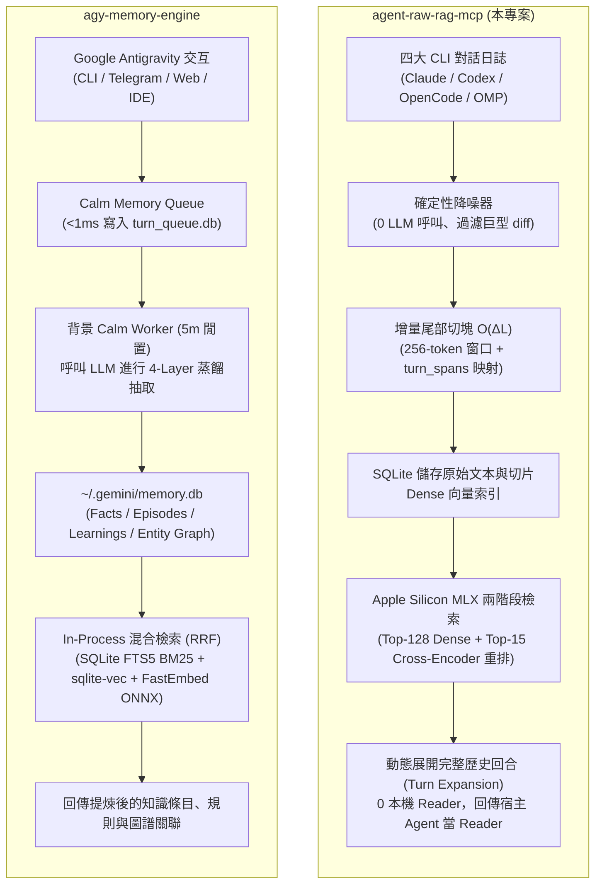

# agent-raw-rag-mcp 與 agy-memory-engine 架構與定位比較報告

> **報告日期**：2026-10-26  
> **專案對比**：`agent-raw-rag-mcp` vs. [`HydStAn/agy-memory-engine`](https://github.com/HydStAn/agy-memory-engine)

---

## 1. 摘要與核心哲學對立

這兩個專案代表了目前 AI Agent 記憶系統設計的兩種根本對立哲學：

* **`agent-raw-rag-mcp`（本專案）**：走 **「Raw-RAG」無損還原路線**。  
  基於論文 *Is Complex Agentic Memory Always Needed? Naive RAG Is Stronger Than We Thought* (arXiv:2610.30755) 的實證發現，複雜的 Agentic 記憶摘要與原子事實抽取往往伴隨嚴重的語意偏差與表徵損失（實證有 21.9% 永久損失）。本專案在**寫入端維持 0 次 LLM 呼叫**，透過確定性降噪與尾部增量切塊，在讀取端以本機 Apple Silicon MLX 兩階段重排（Qwen3-Embedding + Qwen3-Reranker 4B），並**動態還原出完整的原始 User/Assistant 對話回合**，主要目標為**解決四大 CLI Coding Agent（Claude Code、Codex CLI、OpenCode、Oh My Pi）在 `/compact` 有損壓縮後的失憶問題**。
* **`HydStAn/agy-memory-engine`**：走 **「Hermes 認知分層蒸餾」路線**。  
  專為 **Google Antigravity (`agy`)** 全通路生態（CLI、Telegram Bot、Web Cockpit、IDE）打造。利用背景 Calm Memory Worker 呼叫 LLM 將對話**抽象提煉為 4 層結構化記憶**（Facts、Episodes、Learnings、Entity Graph），並結合本機超輕量級 **SQLite FTS5 (BM25) + `sqlite-vec` (C 原生向量擴展) + FastEmbed (ONNX)** 實現混合檢索與倒數排名融合（RRF）。

---

## 2. 端到端流程對比

---

## 3. 詳細維度比較表

| 比較維度 | `agent-raw-rag-mcp` (本專案) | `HydStAn/agy-memory-engine` |
| :--- | :--- | :--- |
| **理論基礎** | **Raw-RAG 論文**（arXiv:2610.30755）：證明 Naive RAG + 原始展開在長對話記憶評測中優於複雜圖譜與摘要。 | **Hermes Agent 認知架構**：模擬人類長期記憶機制，分為語意、情節、程序學習與關聯圖。 |
| **寫入端 LLM 開銷** | **0 次 LLM 呼叫**。純確定性文字過濾與 AST/Token 切塊，無 API 成本與額外延遲。 | **需呼叫 LLM 萃取**。對話閒置時由背景 Worker 進行 1 次 LLM pass 提取事實與經驗。 |
| **支援 Agent 生態** | **跨 4 大主流 CLI Coding Agent**： • Claude Code (`~/.claude`) • Codex CLI (`~/.codex`) • OpenCode (`~/.local/share/opencode`) • Oh My Pi (`~/.omp`) | **深耕 Google Antigravity (`agy`) 全通路**： • AGY CLI Hooks (`hooks.json`) • Antigravity Telegram Bot • Web Cockpit / IDE Extension |
| **檢索技術棧** | **本機 Apple Silicon MLX 兩階段漏斗**： • 粗排：Qwen3-Embedding-4B (Top-128) • 精排：Qwen3-Reranker-4B (Top-15) • 時序重排：依原始對話時序升冪排列 | **In-Process 輕量混合檢索 (RRF)**： • 關鍵字：SQLite FTS5 + BM25 • 向量擴展：`sqlite-vec` (C 原生 SIMD) • 嵌入模型：FastEmbed ONNX (MiniLM-L12-v2 384d) |
| **記憶呈現形式** | **動態展開為完整的歷史對話回合**（Full Turn Context），保留完整的推理過程、因果脈絡與原貌。 | **結構化條目與經驗規則**（例如：「伺服器 IP: 192.168.1.10」、「刪除操作需二次確認」）。 |
| **抗失憶定位** | **抗 `/compact` 有損壓縮與跨工具上下文遺失**：避免摘要滾動遺忘技術細節。 | **跨會話規則累積與實體管理**：建立長期穩定的個人偏好與專案常數。 |
| **硬體與資源需求** | 適合配備 **Apple Silicon (統一記憶體 32GB~64GB+)** 之環境，透過 MLX 運行 4B 級模型。 | **極致輕量**，CPU + ONNX 即可執行，記憶體開銷低，可在輕量 VPS 或背景常駐運作。 |
| **精準度特長** | **語意理解深度與長上下文回溯**：Cross-Encoder 精準度極高，完全還原程式碼決策脈絡。 | **精確符號匹配（Zero Hallucination）**：BM25 對 IP、Port、路徑、專有名詞 100% 精準命中。 |

---

## 4. 深度技術剖析

### 4.1 `agent-raw-rag-mcp`：以原始切片對抗表徵損失

1. **確定性降噪（Deterministic Sanitizer）**：
   - 程式開發日誌 90% 以上為代碼瀏覽輸出與命令回傳。
   - 本專案 100% 保留 User Prompt 與 Assistant 推理正文；Tool 輸出壓縮為單行動作摘要，僅在失敗時保留至多 15 行 stderr。
   - 程式碼全文與巨型 git diff 直接剝除，不消耗向量索引空間。
2. **$O(\Delta L)$ 尾部增量切塊**：
   - 採 `tiktoken` 256-token 窗口（步長 224 tokens，重疊 32 tokens）。
   - 鎖定已滿區塊與向量，僅重切末端未滿切片與新增區塊，並維護 `turn_spans` 回合映射表。
3. **動態呈現期回合展開（Display-Time Turn Expansion）**：
   - 命中緊湊切片後，反查 `turn_spans` 還原完整的 User/Assistant 回合，跨切片重疊部分自動去重，並交由外部宿主 Agent 擔任 Reader。

### 4.2 `agy-memory-engine`：以認知分層建構專屬知識庫

1. **Calm Memory Debouncing**：
   - 交互期間僅花費 <1ms 將對話排入 `turn_queue.db`，完全不阻塞即時對話。
   - 在會話閒置 5 分鐘或達 15 分鐘超時後，觸發背景 Worker 集中處理。
2. **四層認知模型（4-Layer Cognitive Model）**：
   - **Layer 1: Facts**：伺服器配置、IP、硬體規格等客觀事實（依賴 FTS5 精確匹配）。
   - **Layer 2: Narrative Episodes**：會話歷史、立場態度、生命週期狀態衰減。
   - **Layer 3: Learnings**：操作教訓、決策準則與啟發式規則。
   - **Layer 4: Entity Graph**：實體與實體間的方向性關係（如 `hosted_on`、`owns`）。
3. **零常駐服務器的 In-Process 混合檢索**：
   - 放棄外部重量級向量資料庫（Chroma/Milvus/Qdrant）與 PyTorch，直接在 SQLite 內透過 `sqlite-vec` 實現向量計算，搭配 RRF 融合演算法兼顧語意與精確字詞。

---

## 5. 選型建議與適用場景

* **選擇 `agent-raw-rag-mcp` 的時機**：
  * 在日常開發中頻繁使用 **Claude Code、Codex CLI、OpenCode、Oh My Pi**，且常在工具間切換或依賴 `/compact` 釋放 Context。
  * 核心需求是**回溯歷史除錯過程、架構討論決策因果**，需要完整的對話原文而非二次轉譯的片段事實。
  * 主機為 Apple Silicon Mac，有充足記憶體運行 MLX 4B 模型以取得最頂級的語意檢索品質。

* **選擇 `agy-memory-engine` 的時機**：
  * 深度依賴 **Google Antigravity (`agy`)** 工具鏈（包括 Telegram Bot 遠端操作與 Terminal CLI）。
  * 核心需求是**長期記住專案配置常數（IP、Port、API Key 規則）與行為約束準則**。
  * 部署環境為輕量 VPS、無專屬 GPU / Apple Silicon 加速的主機，追求極致低延遲（<2ms）與最小記憶體佔用。

---

## 6. 結論與重要限制

* **`agent-raw-rag-mcp`**：不適合用來作為全域知識圖譜或實體關聯查詢器；其強項在於**時序型對話歷史無損還原**。
* **`agy-memory-engine`**：不適合用來做精確代碼回溯或複雜多輪上下文除錯還原；因為經過 LLM 蒸餾後的 Facts/Learnings 已丟失原始對話中的程式碼細節與即時推理軌跡。
