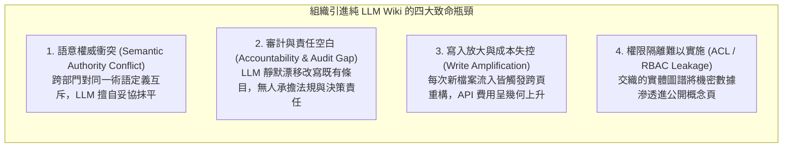
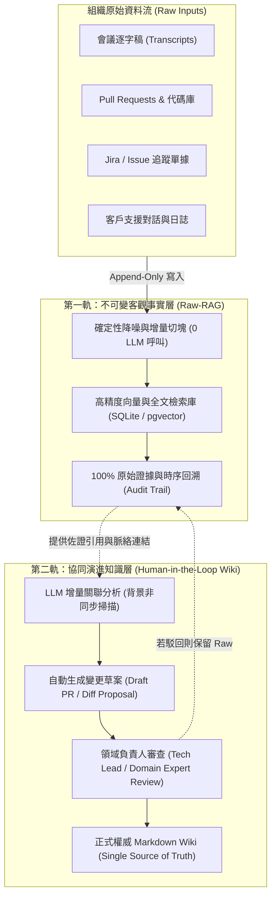
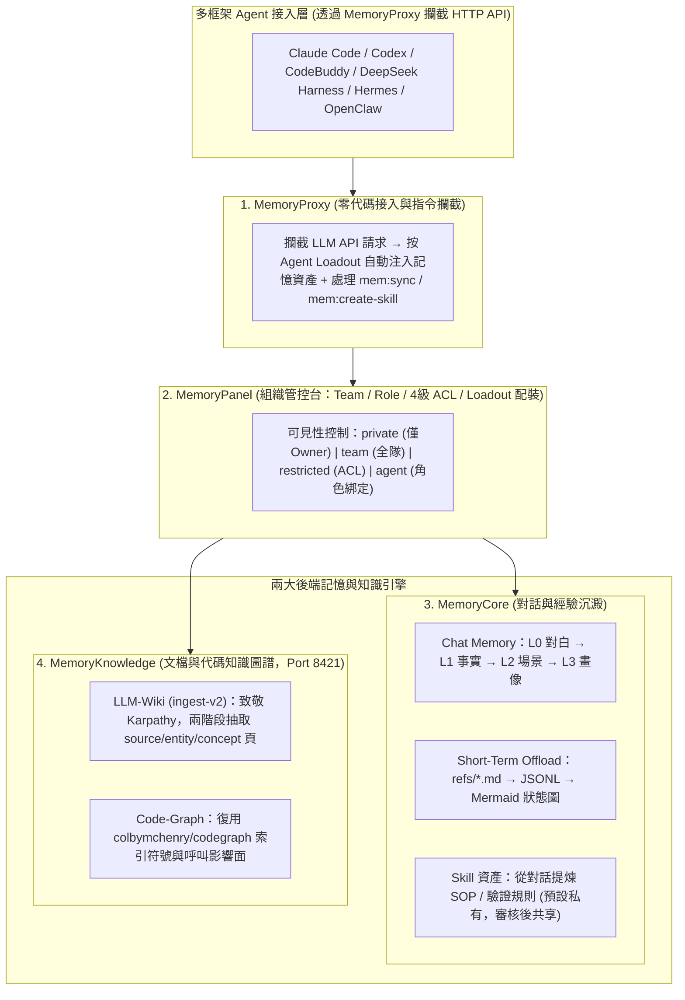

# LLM 抽象萃取、Karpathy LLM Wiki 與組織運作可行性深度分析

> **報告日期**：2026-10-26  
> **主題探討**：LLM 早期抽象萃取（Raw-RAG 實證）、Andrej Karpathy 的 LLM Wiki 模式與 [`TencentCloud/TencentDB-Agent-Memory`](https://github.com/TencentCloud/TencentDB-Agent-Memory) 之深度源碼級辨析，及其在企業與組織運作層面的可行性評估。

---

## 1. 核心摘要（Executive Summary）

* **觀點釐清**：Raw-RAG 論文（arXiv:2610.30755）對「LLM 早期抽象抽取」的批評，**並不代表 Andrej Karpathy 的 LLM Wiki 是個錯誤模式**；兩者分別解決了不同層次的問題。
  * **Raw-RAG** 針對的是高動態、含代碼細節的**「工作對話記憶（Working Episodic Memory）」**，禁止早期抽象以避免 21.9% 永久表徵損失。
  * **LLM Wiki** 針對的是長程概念沉澱的**「語意知識管理（Semantic Knowledge Base）」**，將 LLM 視為編譯器，將非結構化資料合成為實體概念頁。
* **組織運作評估**：直接將個人版 LLM Wiki 模式引入組織**不可行且伴隨巨大風險**。組織面臨**語意權威衝突、審計責任空白、寫入成本放大與權限隔離（ACL）難以切割**四大結構性難題。
* **對 `TencentDB-Agent-Memory`（含最新預設分支 `feat/server_team` v2.0）的源碼級實證評估**：
  * **關鍵架構演進（從 v0.3 個人插件到 v2.0 團隊記憶中台）**：該倉庫舊版 `main` 分支（`v0.3.6`）僅為單機個人畫像與短期卸載插件；但其**最新預設分支 `feat/server_team`（`v2.0.x`）**已重構為面向組織與多 Agent 團隊的四合一平台（`MemoryCore` + `MemoryKnowledge` + `MemoryPanel` + `MemoryProxy`），將記憶拆分為四大資產：**Chat Memory、Skill、LLM-Wiki（直接致敬 Karpathy）、Code-Graph**。
  * **針對組織痛點的三大工程突破（`MemoryKnowledge` & `MemoryPanel`）**：
    1. **防篡改鎖定（`locked: true`）与大頁增量追加（`appendMerge`）**：人工編輯過的 Wiki 頁面會標記 `locked: true`，禁止 LLM 覆寫；超過 4,000 字的頁面改走尾部增量追加而非整頁重寫，大幅降低靜默漂移與 Token 成本。
    2. **Raw Source 雙向綁定與級聯清理（`sources` + `cascade.ts`）**：強制每個 Wiki 頁記錄來源檔案陣列，刪除底層 Raw 文檔時自動級聯更新頁面並清理懸空 `[[wikilink]]`。
    3. **四級權限（`private / team / restricted / agent`）與 Agent Loadout**：透過控制面板按角色配發不同記憶背包，解決跨部門權限隔離問題。
  * **仍存在的局限與與 `agent-raw-rag-mcp` 的本質差異**：
    1. **對話層（`MemoryCore`）仍偏向個人畫像且缺無損回合展開**：其 L1 提取仍過濾 AI 技術輸出，且直至 v2.0.1 Roadmap 才計畫補齊面板上的 L0/L1 原文搜尋與人工編輯；缺乏 `Raw-RAG` 的 256-token 增量切塊、Cross-Encoder 精排與 `turn_spans` 完整回合展開。
    2. **接入成本差異**：`MemoryProxy` 需架設反向代理容器攔截 API 請求（改 Base URL），而 `agent-raw-rag-mcp` 直接旁路讀取本機原生 CLI 日誌，零侵入且無需走代理伺服器。
* **最佳實務解法**：組織運作應採**「雙軌／三層架構」**——底層對話與除錯軌跡以 `Raw-RAG` 形式無損留存；任務過程借鏡其 Mermaid 符號化狀態機；領域文檔則結合 `MemoryKnowledge` 的 Karpathy 雙階段 Ingest（`locked` 保護 + `sources` 級聯）與人工審批治理。

---

## 2. 本質辨析：Raw-RAG 的批判 vs. Karpathy 的 LLM Wiki

### 2.1 兩者情境與目標的根本差異

| 比較維度 | Raw-RAG (對話型工作記憶) | Andrej Karpathy's LLM Wiki (知識庫管理) |
| :--- | :--- | :--- |
| **主要定位** | 對話紀錄、即時除錯軌跡、工程決策上下文。 | 長期閱讀筆記、學科概念、領域專有名詞與關聯。 |
| **核心目標** | 精準回溯「過去某次互動做了什麼、命令輸出為何」。 | 跨文件合成「某個實體概念在整體知識中的定位」。 |
| **對抽象的態度** | **嚴格禁止寫入期抽象**（保留 100% 原始對白，降噪代碼）。 | **必須進行抽象**（若不跨篇提煉實體，每次檢索皆為孤島）。 |
| **資訊損失代價** | 遺失參數、錯誤堆疊或代碼細節會導致除錯完全中斷。 | 容許適度概括，追求實體之間的宏觀連結與複利。 |

### 2.2 Karpathy 模式的核心不變量：編譯器思維
Karpathy 提出的架構並非完全拋棄原始憑證，其關鍵在於清晰的職責分離：
1. **`Raw Sources`（不可變基底）**：原始論文、文章、轉錄文字原樣封存，不被修改。
2. **`LLM as Compiler`（編譯管線）**：LLM 充當編譯器，負責比對、交叉引用與提取實體。
3. **`Wiki`（可變編譯產物）**：以 Markdown 呈現編譯後的中介表示層（Intermediate Representation）。

> [!NOTE]
> 這意味著 **Karpathy 的 LLM Wiki 本質上也依賴不可變的 Raw 底層**。如果拋棄原始來源只留 LLM 生成的 Wiki，其脆弱度與傳統 Agentic Memory 無異。

---

## 3. 組織運作層面：為何直接套用純 LLM Wiki 會失效？

在「個人場景（PKM）」下，LLM Wiki 運作極為順暢，因為**個人即是唯一的真理仲裁者**。但在 50 至 500 人以上的組織團隊中，會遭遇四大結構性阻礙：



### 3.1 語意權威衝突（Semantic Authority Conflict）
* 在企業中，各部門對詞彙的定義具備專業約束力。例如「活躍用戶（Active User）」：
  * **行銷部**：過去 30 天內有開啟 App 者。
  * **財務部**：過去 90 天內有產生付費扣款交易者。
  * **資安/SRE 部**：目前在 Auth 伺服器持有有效 Token 者。
* **失敗點**：若由 LLM 自行維護綜合 Wiki，大模型傾向生成「平滑、折衷」的中庸描述，導致業務與技術執行產生災難性偏差。

### 3.2 審計與責任空白（Accountability Gap）
* 組織流程高度重視合規與責任追溯（例如：SOP 異動依據、資安架構基準變更）。
* **失敗點**：LLM 在吸收新資訊更新 Wiki 時，存在**靜默漂移（Silent Knowledge Drift）**特性，可能在無人察覺的情況下覆蓋掉關鍵的免責條款或核心架構限制，出事時無法界定責任人。

### 3.3 寫入放大與經濟成本（Write Amplification Cost）
* 組織資訊流入量巨大（每日數百則 Jira、PR、會議紀錄、客戶回報）。
* **失敗點**：在 Raw-RAG 架構中，新增文件僅需簡單的向量化與儲存（成本極低）；但在 LLM Wiki 中，每份新文件都需觸發多個既有 Markdown 頁面的比對與改寫，造成運算成本與延遲暴增。

### 3.4 權限隔離（ACL / RBAC）難以切割
* 組織資料天生具備不同機密等級（公開、內部、高管限閱、人事薪資）。
* **失敗點**：LLM 在進行跨篇實體提煉時，極易將機密上下文抽取並拼裝到公開的實體筆記中，導致權限控制在 Markdown 層面徹底穿透。

---

## 4. 組織級解決方案：雙軌知識架構（Bimodal Architecture）

在企業組織中落地時，應將**「不可變的事實層」**與**「可進化的知識層」**解耦，建立如下標準雙軌作業流：



### 雙軌運作機制說明：
1. **第一軌（Raw-RAG）負責「保全客觀真實」**：
   * 所有對話、日誌與原始文件以 Append-Only 方式保存，採用確定性切塊，**禁止 LLM 竄改與過早抽象**。
   * 提供 100% 精準的法規審計、技術除錯與歷史責任歸屬。
2. **第二軌（LLM Wiki）負責「提出演進草案」**：
   * LLM 不具備直接寫入權限，其角色轉變為**「知識庫審查員（Knowledge Scribe）」**。
   * 當發現多個 Raw 來源形成新共識時，自動建立一份 **Markdown 變更請求（Pull Request）**，附帶精確的 Raw 來源引用。
   * 由領域專家（Domain Expert）點擊核准（Merge）後，才正式更新公司 Wiki。

---

## 5. 個人 vs. 組織知識架構評估表

| 評估維度 | 個人運作 (Andrej Karpathy 模式) | `TencentDB-Agent-Memory v2.0` (`feat/server_team`) | 組織運作 (企業級雙軌落地模式 + `Raw-RAG`) |
| :--- | :--- | :--- | :--- |
| **核心抽象標的** | 領域實體概念、讀書筆記、跨主題知識連結。 | **四大記憶資產**：<br>1. `Chat Memory`（L0–L3 用戶畫像）<br>2. `Skill`（可重用流程與驗證規則）<br>3. `LLM-Wiki`（直接致敬 Karpathy 抽取 `source/entity/concept`）<br>4. `Code-Graph`（整合 `colbymchenry/codegraph`） | 企業架構決策（ADR）、工程規範、業務領域模型與 100% 無損除錯實證。 |
| **Wiki / 高層寫入治理** | LLM 全自動覆寫、重構與修復連結。 | **混合保護機制（`merge.ts`）**：<br>• 人工編輯頁標記 `locked: true` 禁止 LLM 覆寫<br>• 小頁（$\le 4000$ 字）LLM 整頁重寫<br>• 大頁（$> 4000$ 字）改走 `appendMerge` 尾部增量追加 | **嚴格受限**；LLM 僅能發起 PR 草案，需領域專家審批 Merge。 |
| **底層 Raw 資料留存** | 個人本機 `/raw` 目錄（原樣保存）。 | **Wiki 層**：保留原始上傳文檔並以 `sources` 陣列 + `cascade.ts` 級聯同步刪除<br>**Chat L0 層**：僅留純文字對話（丟棄工具呼叫），短期 `refs/` 定期清理。 | 企業級不可變 Raw-RAG 儲存層（確定性降噪 + 256-token 切片 + `turn_spans` 完整回合展開 + 失敗 stderr 留存）。 |
| **檢索與還原精度** | Obsidian 雙向連結 + 檔案搜尋。 | **Wiki 層**：SQLite FTS5 + `graphology` 多跳 BFS 圖譜展開<br>**Chat 層**：FTS5 + Embedding RRF（單條訊息粒度，無 Cross-Encoder 與回合展開）。 | Dense Top-128 + Cross-Encoder Top-15 + 時序重排 + 呈現期完整回合展開。 |
| **權限與多租戶隔離** | 無（個人單機）。 | **`MemoryPanel` 四級可見性**：<br>`private`（僅 Owner）/ `team`（全隊）/ `restricted`（User/Role/Agent ACL）/ `agent`（依角色定向配裝 Loadout）。 | 支援專案／部門 Namespace 隔離與底層文件級 ACL。 |
| **CLI 接入方式** | 手動或本地腳本。 | **`MemoryProxy`（API 反向代理）**：攔截 Claude Code / Codex / CodeBuddy 的 HTTP API 請求並改寫 Prompt。 | **本機原生日誌解析 + 標準 MCP Server**：旁路增量讀取本機資料庫，零代理、不攔截 API。 |

---

## 6. 深度案例剖析：`TencentCloud/TencentDB-Agent-Memory` 為什麼這麼設計？它如何處理組織面向議題？

若同時檢視該倉庫的舊版 `main` 分支（`v0.3.6`，單體插件）與**最新預設分支 `feat/server_team`（`v2.0.x`，團隊記憶中台 Monorepo）**，可以非常清楚地看到騰訊雲團隊的演進動機——**他們正是為了處理「從個人記憶走向組織級多 Agent 協作」的四大痛點，才在 v2.0 進行了徹底的架構重構**。

### 6.1 `v2.0` (`feat/server_team`) 的四件套組織級架構

在 `feat/server_team` 分支中，系統從單一插件拆分為四個微服務模組，並將記憶定義為**四大可管理、可配裝的資產（Memory Assets）**：



---

### 6.2 它在「組織級 Raw Resource 管理」與「LLM 抽象思考」上做對了什麼？（源碼實證）

對照我們在第 3 節指出的「組織引進純 LLM Wiki 的四大致命瓶頸」，`TencentDB-Agent-Memory v2.0` 在 `MemoryKnowledge` 與 `MemoryPanel` 中給出了極具針對性的工程解法：

#### 1. 針對「LLM-Wiki 靜默漂移與語意覆寫」：引入 `locked: true` 硬鎖定與 `appendMerge` 大頁增量追加
檢視 `MemoryKnowledge/src/engines/wiki/ingest-v2/merge.ts`：
* **人工權威優先（`locked: true`）**：當領域專家在面板手工編輯過某個 Wiki 頁後，Frontmatter 會寫入 `locked: true`。此後當 LLM Ingest 新文檔並嘗試更新該頁時，`mergePage()` 會直接攔截：
  ```ts
  if (oldParsed.frontmatter.locked === true) {
    return { action: "skip", reason: "目标页 locked，跳过合并" };
  }
  ```
  這避免了 LLM 靜默覆蓋人類專家已經拍板的規範。
* **大頁不重寫，改走尾部追加（`DEFAULT_FULL_REWRITE_MAX_CHARS = 4000`）**：
  為了防止 LLM 在整頁重寫時偷偷丟失舊事實（或消耗巨量 Output Token），當既有頁面超過 4,000 字時，系統自動切換為 `appendMerge()`，強制 LLM **「只輸出舊頁尚未包含的增量 Markdown 片段」**並直接拼接到舊頁末尾；若新舊內容衝突，`MERGE_SYSTEM` 明確要求：**「保留雙邊說法並顯式標註分歧（keep both and explicitly note the disagreement）」**，而非擅自妥協抹平。

#### 2. 針對「文檔型 Raw Resource 溯源與生命週期」：`ensureSources` + `cascade.ts` 級聯清理
檢視 `MemoryKnowledge/src/engines/wiki/ingest-v2/index.ts` 與 `cascade.ts`：
* 每次 Ingest 採用**兩階段編譯**（`buildAnalysisPrompt` 先做抽取計畫 $\to$ `buildGenerateFromAnalysisPrompt` 產出 `<<<FILE path="wiki/entities/...">>>`），並強制在每個生成的 Markdown 頁面 YAML 頂部維護 `sources: ["原始檔案A.md", "原始檔案B.md"]` 的聯集（`reconcileSources`）。
* 當組織刪除或淘汰某份過期的 Raw 原始文檔時，`cascade.ts` 會自動掃描所有 Wiki 頁的 `sources`：
  * 若某個 Wiki 頁**僅依賴**該被刪源，則自動刪除該頁，並巡檢全庫將指向該頁的懸空 `[[wikilink]]` 降級為純文字；
  * 若該頁由**多份原始文檔共同支撐**，則僅從 `sources` 陣列移除該源。這真正做到了 Karpathy 所說的「LLM 作為編譯器、Wiki 作為 Raw 的衍生視圖」。

#### 3. 針對「組織權限隔離（ACL）與上下文污染」：記憶不是全局塞入，而是按角色配發「Agent Loadout」
* 在組織中，如果把全公司的 Wiki、代碼圖譜與歷史對話全部掛給同一個 Agent，不僅機密外洩，檢索噪音也會淹沒上下文。
* `MemoryPanel` 設計了 **`private`（僅 Owner 可讀，連團隊 Admin 都不可讀） / `team` / `restricted`（ACL） / `agent`** 四級權限，並提出 **「Agent Loadout（裝備背包）」** 概念：
  * 新產生的 `Chat Memory` 與 `Skill` **預設一律為 `private`**，必須經過人工明確審核分享才會變成 `team` 資產。
  * 不同職能的 Agent 只掛載自己需要的記憶包（例如：給 `Reviewer Agent` 掛載「歷史事故 Chat Memory + Release Checklist Skill + CodeGraph」）。

#### 4. 針對「單次複雜任務的過程抽象」：短期記憶的 Mermaid 認知狀態機 + 認知墓碑
* 在 `MemoryCore/src/offload/local-llm/prompts/l2-prompt.ts` 中，將單次任務中繁雜的工具呼叫輸出卸載至 `refs/*.md`，並由 LLM 濃縮為 `flowchart TD` 的 Mermaid 狀態圖，將走不通的死胡同標記為 `status: blocked`（認知墓碑），且強制透過 `node_mapping` 將每個圖譜節點綁定回底層 `tool_call_id`。

---

### 6.3 既然 `TencentDB-Agent-Memory v2.0` 已經做到這樣，它跟本專案 `agent-raw-rag-mcp` 的核心差異與互補點在哪？

即使在最新的 `v2.0`（`feat/server_team`）下，檢視其底層源碼與 [`ROADMAP_CN.md`](https://github.com/TencentCloud/TencentDB-Agent-Memory/blob/feat/server_team/ROADMAP_CN.md)，它在**「工程師日常 Coding 對話的無損回溯」**上，與 `agent-raw-rag-mcp` 仍有三個本質差異：

| 深度對比維度 | `TencentDB-Agent-Memory v2.0` (`feat/server_team`) | 本專案 `agent-raw-rag-mcp` (`Raw-RAG`) |
| :--- | :--- | :--- |
| **1. 對話層（`MemoryCore`）對技術細節的態度** | **重度依賴早期 LLM 摘要，且 L1 丟棄 AI 技術輸出**：<br>• `l0-recorder.ts` 只錄 `user`/`assistant` 純文字，長期底座不存工具呼叫與失敗 stderr。<br>• `l1-extraction.ts` 僅抽 `persona/episodic/instruction`，明文規定丟棄 AI 助手輸出的分析。<br>• 直至 `v2.0.1` Roadmap 才計畫在面板補上「L0/L1 記憶搜索」與「L1-L3 手動編輯修正」。 | **寫入端 0 LLM 呼叫，100% 無損保存工程決策與錯誤現場**：<br>• 確定性降噪器（`sanitizer.py`）100% 保留 User 與 Assistant 技術推導原文，並保留單行工具軌跡與失敗命令最後 15 行 `stderr`。<br>• 徹底消除早期 LLM 摘要造成的 **21.9% 永久表徵損失**。 |
| **2. 對話檢索與上下文還原品質** | **FTS5 + Embedding RRF，單條訊息粒度**：<br>• `tdai_conversation_search` 無 Cross-Encoder 精排，且僅回傳孤立的單條訊息，缺乏前後文回合展開與時序重排。 | **Apple Silicon MLX 兩階段精排 + 動態完整回合展開**：<br>• `Qwen3-Embedding-4B` (Top-128) $\to$ `Qwen3-Reranker-4B` (Top-15) $\to$ 依原始時序重排 $\to$ 透過 `turn_spans` 還原**完整 User/Assistant 對話回合**。 |
| **3. 跨 CLI 工具的接入架構與侵入性** | **重量級 Docker 三件套 + `MemoryProxy` API 攔截**：<br>• 必須啟動 `memory-core` + `memory-hub` + `proxy` 容器，並將 Claude Code / Codex 的 API Base URL 改指到 Proxy，由 Proxy 攔截 HTTP 請求並改寫 Prompt。 | **極致輕量本機旁路解析 + 標準 MCP Server**：<br>• 直接增量讀取 `~/.claude`、`~/.codex`、`opencode.db`、`~/.omp` 原生本機檔案，**完全不攔截 API 流量、不改 Base URL**，透過 MCP 按需調用。 |

---

## 7. 結論與組織級演進建議

### 7.1 綜合結論
1. **你的直覺完全正確**：`TencentDB-Agent-Memory` 在最新的 `feat/server_team`（`v2.0`）分支中，確實已經從單純的個人插件，演進為一套試圖解決**組織級經驗複用、權限隔離（4 級 ACL）、角色裝配（Agent Loadout）與 Karpathy 式文檔編譯（`MemoryKnowledge`）**的團隊記憶中台。
2. **兩者的真實關係（20% 重疊、80% 分工互補）**：
   * **`TencentDB-Agent-Memory v2.0` 強在「頂層組織治理與文檔／Skill 資產化」**：它的 `MemoryKnowledge`（兩階段編譯靜態文檔為 Wiki、`locked: true` 人工鎖定、大頁增量追加、`sources` 級聯刪除）與 `MemoryPanel`（私有轉團隊審核、Agent Loadout），非常適合處理**組織靜態文檔（PRD/設計書）與標準 SOP（Skill）的抽象與分發**。
   * **`agent-raw-rag-mcp` 強在「底層跨 CLI 工程對話的無損保真與精準回溯」**：騰訊方案在 `MemoryCore`（對話記憶層）依然走「早期 LLM 抽象抽取用戶畫像」路線，會過濾掉 AI 的技術推導與工具報錯細節；而你的 `agent-raw-rag-mcp` 以 **0 寫入 LLM 成本 + MLX Qwen3 兩階段精排 + 完整回合展開**，守住了「對話與除錯現場 0 表徵損失」的底線。

### 7.2 借鏡 `TencentDB-Agent-Memory v2.0` 的三大高價值設計
若未來要擴充本機或團隊的知識工作流，最值得從 `TencentDB-Agent-Memory v2.0` 吸收的三個機制為：
1. **Wiki 頁面級鎖定（`locked: true`）與大頁尾部追加（`appendMerge`）**：在維護 Obsidian / Karpathy Wiki 時，人類專家親手定稿的區塊加鎖禁止 LLM 改寫；長頁面只追加新段落與顯式衝突標註，不整頁重寫。
2. **`sources` 陣列與級聯清理（`cascade.ts`）**：每一頁抽象出的 Wiki 強制記錄來源 Raw 檔名或 `session_id`，確保「抽象層」永遠能追回「原始層」。
3. **短期任務的 Mermaid 認知狀態圖（含 `blocked` 認知墓碑）**：在長程除錯中，用精簡的 Mermaid 圖記錄「哪些假設已證偽（`blocked`）」，並將節點 `node_id` 綁定回 `agent-raw-rag-mcp` 的 `turn_spans`。
