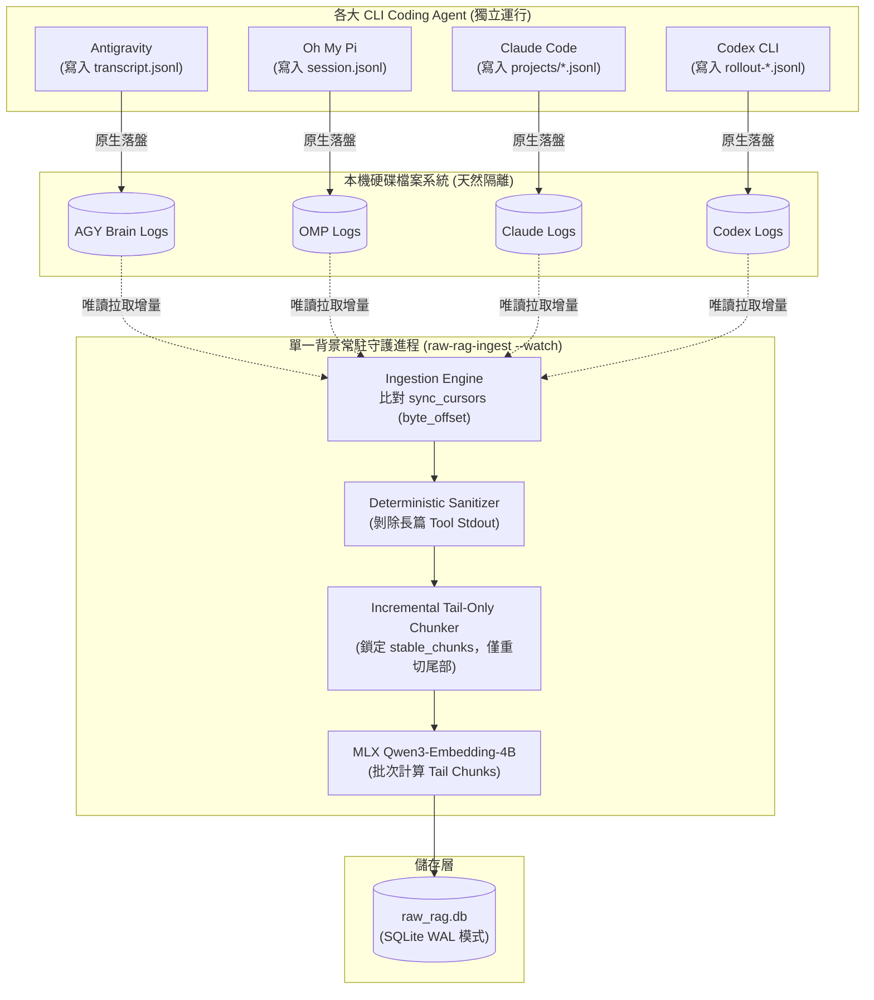
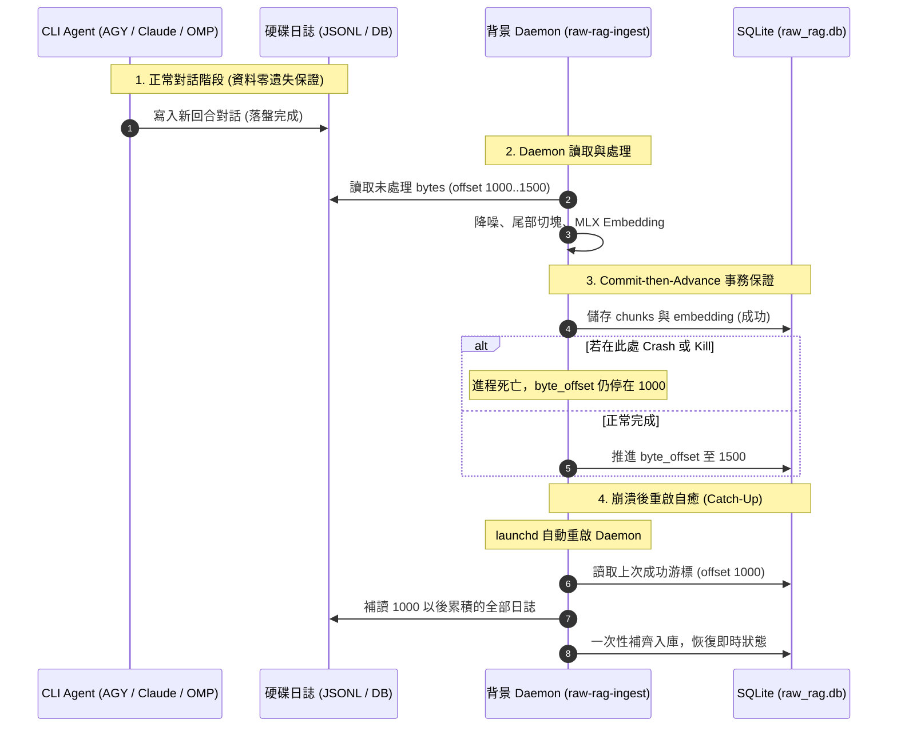

# Raw-RAG 背景常駐增量更新、多 Agent 併發處理與 Failsafe 架構分析

> **作者 / 專案**：`agent-raw-rag-mcp` 架構工程報告  
> **日期**：2026-10-26  
> **目標讀者**：AI 代理系統架構師、本機 Coding Agent 使用者（同時使用 Antigravity、Oh My Pi、Claude Code、Codex）  
> **實作環境**：Apple Silicon (64GB Unified Memory), macOS 26, MLX, Python 3.12, SQLite WAL  

---

## 1. 執行摘要（Executive Summary）

長對話記憶系統在多 CLI Coding Agent 並行工作的場景下，面臨三大核心架構挑戰：
1. **資料流模式（Push vs. Pull）**：Agent 產生對白時，究竟是主動 RPC 推送給伺服器，還是背景監聽拉取？
2. **多 Agent 資源併發（Concurrency & Resource Contention）**：當使用者同時開啟 Antigravity、Oh My Pi (`omp`)、Claude Code 與 Codex 進行不同子任務時，如何避免 Metal GPU 運算與記憶體被反覆搶佔？
3. **故障自癒與容錯（Failsafe & Crash-Recovery）**：當背景常駐進程遭遇異常崩潰（OOM、系統休眠、Kill）時，資料會不會遺失？如何保證無損恢復？

本報告深入剖析 `agent-raw-rag-mcp` 的設計，實證說明為何 **「基於日誌游標拉取（Cursor-based Log Scraper）+ 單一背景守護進程（Single Daemon）」** 是 Apple Silicon 本機環境下處理多 Agent 併發的最佳架構，並提供完整的 Failsafe 與 macOS LaunchAgent 配置規範。

---

## 2. 資料流本質：是 Pull（日誌拉取），不是 Push（主動推送）

### 2.1 解除 Agent 阻斷式依賴

傳統記憶伺服器常要求 Agent 客戶端在每一輪對話結束時，透過 HTTP/gRPC 將資料「推（Push）」給 Daemon。這種模式在 CLI Coding Agent 上有致命缺點：
* **前台卡頓**：若 Daemon 繁忙或未啟動，Agent 的對話流程會被阻塞或拋出連線超時。
* **強耦合侵入**：必須深度修改每個 Agent 的原始碼或外掛生命週期。

`agent-raw-rag-mcp` 採用了 **Pull-based（日誌游標監聽）** 機制：



* **Agent 行為保持純粹**：Agent 只需專注在與使用者對話並將日誌自然寫入磁碟，完全無須感知記憶 Daemon 是否存在。
* **Daemon 扮演被動拉取者**：Daemon 定期檢查各日誌檔案的大小與上次記錄的 `byte_offset`，只有在檔案長度增加時才進行增量讀取。

---

## 3. 多 Agent 併發架構分析（Concurrency Architecture）

當開發者同時開啟 **Antigravity**、**Oh My Pi**、**Claude Code** 與 **Codex** 進行多工協同開發時，系統提供四層併發保護：

### 3.1 來源層：實體隔離（Zero File Contention）
各 Agent 本身寫入的是各自完全獨立的目錄與檔案，物理上不存在檔案鎖（File Lock）爭奪：
- **Antigravity**：`~/.gemini/antigravity-cli/brain/<uuid>/.system_generated/logs/transcript.jsonl`
- **Oh My Pi**：`~/.omp/agent/sessions/<slug>/*.jsonl`
- **Claude Code**：`~/.claude/projects/<slug>/*.jsonl`
- **Codex CLI**：`~/.codex/sessions/**/rollout-*.jsonl`

### 3.2 運算與記憶體層：單進程批次（Batching）vs 多進程爭搶
在 64GB Unified Memory 主機上，多 Agent 同時發動增量更新的最大隱患是 **Metal GPU 資源爭搶** 與 **記憶體反覆膨脹**：

| 指標 | 各 Agent 各自獨立 Hook 進程 | 單一背景常駐 Daemon (`--watch`) |
| :--- | :--- | :--- |
| **進程數量** | 瞬態 4 個 Python CLI 進程 | **常駐 1 個 Python 進程** |
| **統一記憶體佔用** | 瞬態膨脹至 $4 \times 2.5\text{ GB} = \mathbf{10.0\text{ GB}}$ | **固定維持 $\sim\mathbf{2.5\text{ GB}}$** |
| **Metal GPU 調度** | 4 個進程在 Metal Graph 上互相搶佔並發觸發上下文切換 | **1 個進程循序或打包成 Batch Forward Pass** |
| **總計算延遲** | 4 次冷啟動載入 + 4 次推論 ($\sim 5\text{ 秒}$) | **1 次批次推論（$\sim 0.38\text{ 秒}$）** |

守護進程在每一輪掃描中，會將 4 個 Agent 最新產生的尾部區塊（通常總計僅 4～6 個 256-token 切片）收集在一起，直接送入 MLX 做一次 Batch Embedding，極致節省 GPU 算力與記憶體頻寬。

### 3.3 儲存層：SQLite WAL 模式（Reader/Writer 互不阻塞）
資料庫核心採用 SQLite 的 **Write-Ahead Logging (WAL)** 模式與高連線逾時配置：
```python
conn = sqlite3.connect(str(self.db_path), timeout=30.0)
conn.execute("PRAGMA journal_mode = WAL;")
conn.execute("PRAGMA synchronous = NORMAL;")
```
1. **讀寫互不阻塞**：當背景 Daemon 正在寫入新 Chunk 時，任何 Agent 隨時呼叫 MCP `raw_rag_search` 進行查詢，讀取與寫入可同時執行，毫無鎖阻塞。
2. **30 秒 Busy Timeout**：極端情況下若有多個進程嘗試提交事務，SQLite 會在微秒級區間自動輪詢重試，杜絕 `database is locked` 錯誤。

### 3.4 游標層：複合主鍵隔離（Cursor Isolation）
資料庫表記錄游標時，採用 `source_key`（如 `claude:/path/...`、`omp:/path/...`）作為 Primary Key。各 Agent 與各 Session 的推進彼此完全隔離，A Agent 推進進度絕不會污染或覆蓋 B Agent。

---

## 4. 故障自癒與容錯機制（Failsafe Architecture）

如果常駐 Daemon 遭遇意外退出（如進程崩潰、OOM、主機強行重開機），系統依賴三層 Failsafe 策略保證資料與服務的絕對安全：



### 4.1 Commit-then-Advance（先入庫，後推進游標）
在 [`cli.py`](file:///Volumes/Samsung970EVOPlus/dev-projects/agent-raw-rag-mcp/src/agent_raw_rag/cli.py) 的實作中：
```python
# 1. 先完成文本切塊、MLX 向量運算與 Chunks 儲存
self._process_turns_for_session(meta, turns)

# 2. 只有儲存全部成功後，才更新游標位置
self.store.save_cursor(
    IngestionCursor(
        source_key=src_key,
        agent=agent_name,
        byte_offset=new_offset,
    )
)
```
* **容錯語意**：此為標準的 **At-Least-Once（至少處理一次）** 機制。
* 若在運算或寫入的任何微秒進程被殺死，游標都不會前進。重啟時會從上一個確定落盤的區段重新讀取，搭配 SQLite 的 `INSERT OR REPLACE` 語意，保證操作具備**冪等性（Idempotence）**。

### 4.2 斷線自動追趕（Catch-Up Synchronization）
* 若 Daemon 離線 5 小時，使用者在此期間進行了數百輪密集開發。
* **復原方式**：只要 Daemon 重新啟動（或使用者手動執行一次 `raw-rag-ingest`），Daemon 比對磁碟檔案目前的長度與資料庫中停留在 5 小時前的舊 offset，會在一次輪詢內將這數百輪增量全數處理完畢，**通常在數秒內即可完全追平進度**。

### 4.3 系統級進程託管：macOS `launchd`（LaunchAgent）
為防止 Daemon 死亡後無人知曉，應透過 macOS 原生的 `launchd` 機制進行守護：

在 `~/Library/LaunchAgents/com.raw-rag.ingest.plist` 建立設定檔：
```xml
<?xml version="1.0" encoding="UTF-8"?>
<!DOCTYPE plist PUBLIC "-//Apple//DTD PLIST 1.0//EN" "http://www.apple.com/DTDs/PropertyList-1.0.dtd">
<plist version="1.0">
<dict>
    <key>Label</key>
    <string>com.raw-rag.ingest</string>
    <key>ProgramArguments</key>
    <array>
        <string>/Volumes/Samsung970EVOPlus/dev-projects/agent-raw-rag-mcp/.venv/bin/raw-rag-ingest</string>
        <string>--watch</string>
    </array>
    <key>RunAtLoad</key>
    <true/>
    <key>KeepAlive</key>
    <dict>
        <key>Crashed</key>
        <true/>
        <key>SuccessfulExit</key>
        <false/>
    </dict>
    <key>StandardOutPath</key>
    <string>/Volumes/Samsung970EVOPlus/dev-projects/agent-raw-rag-mcp/data/daemon.log</string>
    <key>StandardErrorPath</key>
    <string>/Volumes/Samsung970EVOPlus/dev-projects/agent-raw-rag-mcp/data/daemon_err.log</string>
    <key>EnvironmentVariables</key>
    <dict>
        <key>HF_HOME</key>
        <string>/Volumes/Samsung980/hf-home/</string>
    </dict>
</dict>
</plist>
```
* **自癒保證**：
  * 開機或登入時自動啟動。
  * **進程崩潰自動拉起**：若遭遇非正常退出（Exit code != 0）或 Crash，macOS 內建的守護程序會在數秒內將其重新喚醒，達成真正的無人值守運作。

---

## 5. 性能與延遲實測（Apple Silicon 64GB 實測數據）

在專案實際環境中，針對單輪對話增量更新進行的基準測試（Benchmark）數據如下：

```
測試環境：
- 機器：Apple Silicon M 系列 (64GB 統一記憶體)
- 權重快取：/Volumes/Samsung980/hf-home/
- 模型：Qwen3-Embedding-4B (4-bit DWQ)
```

| 執行階段 | 常駐暖機模式 (`--watch` / LaunchAgent) | 每次重新執行 CLI (冷啟動) |
| :--- | :---: | :---: |
| **讀取磁碟日誌與 Sanitizer 降噪** | `< 2 ms` | `< 2 ms` |
| **Tail-Only Tokenizer 切塊** | `< 1 ms` | `< 1 ms` |
| **Python 解譯器與 MLX 模型載入** | `0 ms` (已長駐統一記憶體) | `~982 ms` |
| **MLX 向量運算 (1 個 256t Chunk)** | **`~368 ms`** *(實測)* | **`~368 ms`** |
| **SQLite WAL 寫入與游標更新** | `< 5 ms` | `< 5 ms` |
| **總耗時（Background Wall-Clock）** | **約 `0.37 秒`** | **約 `1.35 秒`** |
| **前台使用者感知延遲** | **`0 ms`（完全零阻塞）** | **`0 ms`（完全零阻塞）** |

---

## 6. 結論與最佳實踐建議

1. **架構模式**：嚴格維持 **Pull-based（日誌監聽）**，絕不採用由 Agent 主動 Push 的阻斷式架構。
2. **多 Agent 併發**：統一由 **單一背景常駐守護進程（`raw-rag-ingest --watch`）** 聚合掃描，避免各 Agent 同時起多個進程爭搶 10GB 記憶體與 Metal GPU。
3. **高可用落地**：將 `--watch` 寫入 macOS `LaunchAgent`，透過 `KeepAlive` 達成系統級崩潰自癒；搭配 SQLite WAL 與 `Commit-then-Advance` 檢查點機制，達成真正零資料遺失。
